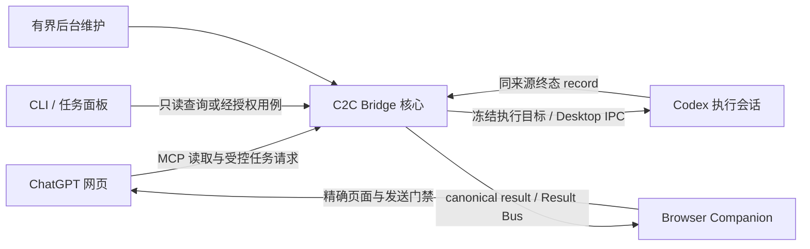

# Architecture

## 执行与回流精简（2026-10-08 当前 checkout）

当前源码已收窄 Executor 合同并复用 Desktop binding 检查；receipt 提交仅投影当前 command，完成条件为 canonical RoutingResult 与 Result Bus，不再新增 R4 outbox entry。生产 Feedback 自动通知只生成 `FINAL_RECEIPT_REQUIRED`；旧执行事件保留证据及严格恢复权限，禁止新发送。接口迁移、历史 drain 和构建边界见[执行与回流精简合同](runtime-simplification.md)。下方 R4 shadow 与 legacy 实施记录保留原日期，不代表当前写入路径或部署状态。

## 单机统一 Gateway 源码状态（2026-10-09 当前 checkout）

源码中的 `gateway register/list/revoke` 维护机器级 workspace/client allowlist；`gateway serve` 以独立的 `machine-gateway` OAuth store 暴露 MCP。项目工具显式接收 workspaceId，每次调用重新核验 client grant 与 canonical root，再复用原 Workspace、Remote、Desktop、execution、feedback、Web Sink handler。各 workspace 的 Controller、Bridge、Result Bus 和业务存储仍各自独立；固定单 workspace `remote serve` 保留兼容。Gateway 不复制任务队列或结果权威。

Gateway 的 Desktop 入口独立于后台 Remote：先 `codex_desktop_status` 核对本机绑定，再以同一 workspaceId/bindingId 调用 `codex_desktop_send`。Gateway 不拥有 Bridge mailbox，直接复用 `deliverCurrentCommand` 和 Desktop sender，遵守现有 idle/busy 门禁；不创建新队列、不自动转投或重发。可信完成 receipt 的短暂 busy-tail 仍按既有 sender 有界等待，其余 busy 拒绝。`codex_submit_task` 始终提交后台 Remote target；Desktop 工具不要求 Remote enabled/official。`accepted` 仅为接收凭据，不是执行完成。这是源码合同，不能代替部署与现场验收。

Gateway MCP 的匿名访问仅用于协议 discovery；工具调用仍要求 bearer OAuth 与原 scope。服务端 `/mcp`、`/oauth/token` 诊断日志只记录 method、固定 path 和 statusCode，不记录 query、body 或 headers。Browser Companion 源码已按 workspace 隔离存储、alarm、页面选择和发送上下文，操作面板请求固定 workspaceId；双项目真实 Send/observed 仍未完成。

机器级 `gateway supervisor` 源码提供 Windows configure/status/validate/set-key/run、DPAPI key 保存、进程身份核验、后台启动 pin 与 GC release 引用保护；没有 Scheduled Task 注册或异常退出自动恢复。已配置时，独立 `ensureBridge` 在 start/startup lease 与自持 machine maintenance 释放成功后等待共享 Gateway；显式 start/restart 的 inherited maintenance 在 `withExplicitSupervisorIntent` 围栏退出后等待。由 machine supervisor 启动或复用 Gateway、Cloudflare origin 与 Secure MCP Tunnel；setup/workspace/doctor/recover 经共享入口覆盖。只有持已验证 launch pin 的后台启动进程会对 initial/handoff 的 machine maintenance 冲突共用 60 秒有界等待；普通前台仍立即报告 busy，超时或取消保留既有所有权证据。后台日志位于机器 state 的 `logs/gateway-supervisor.out.log`，不写入 Gateway 权威目录。继承 maintenance 的 rollout 跳过共享 Gateway，stopped intent 不启动或停止它。没有配置返回原 workspace 行为；Gateway 失败保留原错误码并报告 Bridge 已就绪，不回退为整组成功，不修改 workspace tunnel、OAuth 或 session。此前的部署与 live 验收时间线见[统一 Gateway 计划](unified-gateway-plan.md)；该源码说明和历史记录均不证明当前安装、进程或浏览器运行状态。

### 旧 Gateway 运行版本迁移

旧 Gateway runtime 没有 `/internal/gateway/health` 合同，即使原服务仍可访问，新 Bridge 也会明确报告 Gateway 身份核验失败，并保留原服务、锁与状态；不回退到仅凭 OAuth metadata 认定健康。需要升级运行版本时，由用户在原 `gateway supervisor run` 前台终端按 Ctrl+C，让 owned parent 与两个隧道子进程正常退出并释放其所有权；确认退出后，再通过稳定 launcher 运行 Bridge `start` 或 `restart`，由已安装 current release 在后台启动整组服务。不得直接删锁或按旧 PID kill；退出或所有权无法确认时停止迁移并报告。

## Companion 当前连接与恢复

- 已配对浏览器的新对话连接使用“网页发起→本机确认目标 URL→提交凭据轮换→既有 Web Sink 收敛”。本机证明只授权回流地址，MCP planner principal 与任务执行权限独立。导出的 local route API 若覆盖 `stateDir`，必须与进程 `C2C_STATE_DIR` 一致：Web Sink store 使用进程级目录，实际 Bridge 生产入口使用默认目录；这是导出 API 的已知限制。已有 MCP 接管流程保留兼容；未知自举或发送不能自动重发或清除。旧绑定 VERIFIED 不代表当前 document 已连接，当前 owner 与服务端证明仍须重新核验。
- Companion 的当前对话连接由 SW 统一派生 `connectionReadiness={ready,reason}`：受保护且认证有效的 transport、authenticated VERIFIED、DONE connect-flow 的精确身份、当前 tab/document/generation/route owner witness，以及当前 workspace 与 browser-companion/chatgpt-web 的权威 Web Sink 同步且 available。popup 使用 MessageSender 页面域，toolbar 与运维视图使用 owner/project 域；`r5cConnected`/`webSinkConverged` 仅为同值兼容别名。新增 reserve 与自动回流 NONE 分支从内部状态重新核验；已有 journal 的只读恢复、续发与 ACK 保留原门禁。派生结果不持久化，不新增协议或连接 ID。SW 重建后或投影失败时，精确 owner 的自动回流心跳按需复用只读 `GET /web-sink/status`，失败至少间隔 2 秒重查，正常 tick 不增加查询。同 tab 重载或同 document 等价 URL 的 generation 变化复用已有只读恢复：journal NONE、原 DONE 身份及前后 owner/document/credential/route 快照不变，fresh `/state` 与 Web Sink 均通过后才更新 witness；不会继承到跨 tab、新对话或 unknown。

连接与自动回流开关、未知消息恢复是独立状态。终态历史只可本地隐藏或恢复；待发送、隔离、journal 与防重放证据不随显示偏好移除。正文观察仍要求唯一精确 ATTEMPT 与规范化全文相等；已知 rich/plain CODE 重建和只读诊断见 [排障说明](troubleshooting.md#唯一发送标记存在但回流仍未确认)。这些均为当前源码合同，部署与真实网页验收另行核对。

## 官方路线源码改造（2026-10-05，历史记录）

当前分支按[官方投递与 Companion 回流](official-route.md)分离执行与回流：独立受 OAuth 保护的 MCP 复用安全文件/Git 读取，通过明确 targetId 向既有 Remote Controller 和官方 App Server 投递；Bridge 在显式 official 模式只保留回流相关入口。官方 turn 结果带独立来源进入 Result Bus，不伪造 Desktop receipt 或测试通过。旧部署、旧消息链及历史记录保留兼容；源码改造阶段本身未迁移机器状态，之后的显式部署见下方快照。

本轮源码验收通过正式串行全量 **164 files /3435 tests**、typecheck 与 canonical build；471 项冻结哈希对应 build `c4b4c18d050137aaae1130b99257e3e13ded21eefbdf6359db2ee22798e28d97`。该全量沿用于部署验收，本次未重跑。在 2026-10-06 00:58:32 的历史快照中，最新独立 gateway run 已于 00:31:49 因用户 Ctrl+C 停止，gateway 与两个隧道进程均已 missing、端口 `48766` 关闭；这不表示生产 Bridge 停止。只读复核确认 Bridge PID `19516` 仍以该 build healthy，`runtimeUpgrade.state=current` 且 `upgradePending=false`；Controller PID `24508`、App Server PID `20172` 保持原 identity，`deliveryMode=official`，471 项冻结哈希匹配。网页 OAuth、真实投递、普通 Project Chat 原生 Events 和 Companion 真实回流仍未验收；22:27 gateway 运行记录是历史快照，OAuth 阻断详情见[开发计划](development-plan.md)。

01:45:17 历史只读复核仍确认 Bridge、Controller、App Server identity 与 build 不变。same-origin-auto 候选配置只通过离线验证，未启动；网页 OAuth、真实投递及 hosted 根因修复仍 pending，A/B 证据与下一步见[开发计划](development-plan.md)。

截至 2026-10-06 08:25 的历史快照：网页 OAuth、普通 Chat 只读 workspace/target 查询、唯一 target 创建、task01/task02 官方投递及按需结果读取均已通过；同 thread 连续性 marker 精确匹配。两条 Result Bus 当时仍 queued 且无 reservation/attempt，自动回流与 Companion 尚未验收；普通 Chat 原生 Events 未通过。

2026-10-06 08:31，用户 Connect 后确认当前对话已连接且自动回流开启；两条 Result Bus 均经真实 Browser Send+ACK 进入 observed，Companion 回流通过。普通 Chat 原生 Events 仍未通过。本轮输入 Key 启动独立 Gateway/隧道，Bridge、Controller、App Server 未重启，业务源码未改，也未额外 install/full/build；细节见[开发计划](development-plan.md)。

08:31–08:34 是单 workspace 历史 live 验收。09:01–09:02 当时的观察显示旧 Bridge/Gateway/Controller/App Server/Tunnel 进程均 missing、48766 无监听且 Bridge stopped；installed build 与旧 durable runtime 记录不能证明当前运行版本。恢复未执行。该历史时点尚未实施多 workspace Gateway；当前源码状态见本页开头，后续待执行的 live 门见[统一 Gateway 计划](unified-gateway-plan.md)。

## 官方路线之前的双向消息模型基线（2026-10-05，历史源码与后端部署）

Bridge 的当前改造合同见 [双向消息收件箱](agent-mailbox.md)：MCP 持久接收 queued，busy 留在队列，idle 后复用安全 Desktop sender；accepted 与可信执行终态分开。Routing 独占任务接收状态，Result Bus 独占 canonical 回流状态，Companion 独占 DOM attempt 证据；单条未知不作为所有新消息的全局阻断。维护/升级与消息权限仍独立严格核验。canonical 回流可逐条隔离原未知 attempt，并在合格目标的面板只读查看结果。

本轮源码门禁已完成：正式串行161 files /3403 tests PASS、unhandled0，465项冻结稳定且进程/监听/temp残留0；typecheck/build/diff通过。构建三方身份精确为 `1326542c3601b2919b1872c1d80ac22aab258b05774c5ce438513b0c5aeba3a8`。canonical installer 完整 artifacts/bootstrap 与 Skill 精确替换通过，稳定 launcher 已将目标部署到 workspace `2582910bf0d2`；08:26 scoped rollout current=1，08:32 复核 built=installed=running、local/admin/named health 同身份且 `runtimeUpgrade=current`。Companion Reload 已由用户确认；页面组件就绪及真实下发/回流端到端未独立观察。Desktop 本机确认已完成，Desktop 与 generic Executor availability=true（采样 activity=busy），投递权限门禁已恢复；真实消息链尚未端到端验收。详见[部署快照](development-plan.md#当前事实与开发阶段2026-10-04-2144asiashanghai)。

## 2026-10-04 历史实现与部署边界

现役源码与待验收范围见 [Gateway 当前状态](unified-gateway-plan.md#当前状态2026-10-08-当前-checkout)；[开发计划](development-plan.md#当前事实与开发阶段2026-10-04-2144asiashanghai)和下文保留各自标注日期的历史实现与部署记录。

本节下方“网页命令 → Desktop”图和对应文字描述的是兼容的 legacy profile；当前 official profile 通过独立 Remote Controller 与 App Server 投递，Bridge official mode 保留 feedback。机器级 Gateway 的多 workspace 源码能力见本页开头；M4/M5 多项目现场验收与旧 feedback Connector 退役仍待完成，见[统一 Gateway 计划](unified-gateway-plan.md)。

B1 进程退出证据、B2 查询/连接与维护分离、B4 canonical 主链、B5 受控任务面板已实现；B3 已评估并决定不迁移 SQLite。固定 registry、Executor/Web Sink 合同、领域存储与安全启动协议继续复用。Supervisor foundation 已随 Core 安装，实际 Scheduled Task/config/runtime 仍 absent/null，独立自动恢复尚未启用。

- `feedback_status`、`feedback_companion_status`、Companion `GET /state` 与任务面板读取现有权威，不负责 reconcile/cleanup/修锁/启动进程。连接修改通过 `bridge/connection.ts` 的 delivery arbiter 和 fresh in-flight 校验；后台 `bridge/maintenance.ts` 分批推进已授权的维护。
- 网页命令经 MCP 与核心执行路由进入 Desktop；Companion 负责回流及面板，不下发开发任务。Desktop accepted、可信终态 record、canonical result、网页 observed/ACK 分别表示不同事实。
- 面板聚合当前 workspace 全部存续任务和异常历史；清理过的历史不重建。写操作需本机限时授权和精确 preview/confirm，不能任意重发 accepted/unknown 或终止执行。长期记录保留不是首版功能。
- 运行判断分别核验进程身份、OS 退出证据和应用健康。shutdown ACK/端口关闭/exit code 都不能替代 HANDLE signaled；不确定时保留 runtime/release pin，不另起实例。 Bridge 关闭入口共享一个完成 Promise：先禁止新增 mailbox 派发并等待已准入调用，再停止接收新 HTTP 连接，给在途连接 1 秒排空期，用 Node 原生 `closeAllConnections()` 关闭剩余连接；所有并发关闭调用等待同一次完整关闭。排空阶段不替代进程退出证明，也不自动强杀外部 unknown 进程。

详细职责与操作条件见 [职责边界第12节](core-plugin-boundaries.md#12-b2b5-剩余源码交付2026-10-04)，连接修复及现场结果见第14–15节。下方 command/B 切片中的未部署或 NEXT 均为当轮历史，当前进度以开发计划为准。

Normal C2C 的 Computer Use 小消息流程仍是独立支持模式；不把它与 Desktop command/receipt、Remote Control 或 Companion 回流混为一条权限链。

## Principles

- **ChatGPT thinks. Codex works.** The bridge never re-implements a coding harness.
- **Normal C2C control plane**: Computer Use carries tiny `[C2C]` messages; separately authorized Desktop tasks use their own delivery/receipt contract.
- **MCP = data plane**: ChatGPT pulls files/diffs/search results itself.
- **Read-only by default**: the 9 base tools remain read-only. Desktop Control is a separately
  authorized plain-text delivery path to one existing Desktop thread; it is not a workspace
  write, shell or arbitrary RPC tool.
- **Workspace is the project security boundary**: each Bridge remains bound to one workspace and its token audience; the machine Gateway authenticates its own OAuth client and checks the explicit grant and canonical root on every project call.

## Components (src/)

| Module | Responsibility |
| --- | --- |
| `bridge/` | Express app assembly, loopback-only listener, port fallback, runtime state, admin API |
| `mcp/` | McpServer with workspace/git/search/session/pairing/feedback/workflow tools (base read-only set + separately guarded Desktop/Remote/feedback schemas); stateless Streamable HTTP transport (fresh server per request, JSON responses) |
| `gateway/` | Machine workspace/client allowlist and Windows foreground Gateway/Tunnel supervisor; routes each call to an independently authorized workspace |
| `desktop/` | Local Desktop binding, behaviorally attested IPC delivery, replay-safe state and delivery status |
| `executor/` | Executor Core 的有限适配器契约、固定注册表及当前 Codex Desktop adapter |
| `endpoints/` | R5 generic executor/web-sink contracts, identity snapshots and fixed plugin registry |
| `executor-control/` | Bridge-owned active executor binding, explicit local bind and frozen delivery target |
| `web-sink-control/` | Bridge-owned active Web Sink binding, explicit browser connect and read-only status projection |
| `auth/` | OAuth 2.1 authorization server: discovery metadata (RFC 8414 + Protected Resource Metadata), dynamic client registration (RFC 7591), authorization-code + PKCE (S256 only), refresh rotation, revocation (RFC 7009). Opaque tokens stored as SHA-256 hashes |
| `pairing/` | PairingCode lifecycle: CSPRNG generation, TTL, attempt limits, IP rate limit, one-time use |
| `workspace/` | Canonical-path containment (realpath of deepest existing ancestor), sensitive-file policy, `.c2cignore`, paginated read/list, ripgrep search with Node fallback, git status/diff with pagination |
| `tunnel/` | `TunnelProvider` interface + Cloudflare Quick and workspace-configured Named Tunnel implementations; business logic is vendor-agnostic |
| `execution/` | JSONL execution records plus optional sanitized command output (`execution_output`) |
| `feedback/` | Production feedback outbox + companion transport: pairing/credential, route-principal attestation (challenge → `feedback_companion_route_confirm` → VERIFIED), reserve/begin-send/ack/retire, stale → `outcome_unknown`, exact late-positive ACK |
| `browser-companion/` | MV3 sources → `dist/browser-companion`: SW-only Bridge HTTP + durable send journal + route-attestation fence; content_scripts use built classic artifacts (including `*-global.js` and classic wrappers), while ESM `dom-adapter`/`turn-observer`/`route-attestation*` stay for the SW import graph; autonomy default OFF; zero DOM/Send unless explicit production one-shot or armed heartbeat; production Send requires **route VERIFIED**；display-only toolbar indicator uses `C/C!/C×`，低频 `alarms` 只做 `/state` discovery |
| `process/` | Daemon spawn/reuse, health probing, graceful shutdown; Windows daemon spawn escapes Job kill-on-close via the Python stdlib helper `daemon_spawn.py` (`CREATE_BREAKAWAY_FROM_JOB` → WMI `Win32_Process.Create` relay, fail closed when Job escape cannot be proven), handing a bounded explicit allowlisted daemon env over through a 0600 JSON file (OS/runtime/path variables plus the exact C2C config set the bridge reads; unknown parent secrets/context excluded; a fresh startup lease is injected explicitly after projection, never inherited from the parent) so the bridge survives its spawner (e.g. Codex) exiting |
| `core/` | Verified machine install metadata, guarded rollout and per-workspace pending upgrades; real installs reclaim unreferenced immutable releases through the existing `gc --apply` gates (maintenance lock, rollout fence, start lock, tombstone + no-follow delete); `--protect-current` never deletes。另承载零业务依赖的共享安全原语：`durable-store.ts`（durable store 事务模板唯一实现点：wx 锁、fsyncSync、initialized marker、tmp wx 0600、原子 rename、noWrite/revision 策略注入）、`evidence-store.ts`（行政证据 store read/write 模板）、`hex.ts`（HEX64 唯一定义）；安全门禁清单与定期审查机制见 [security-gate-audit](security-gate-audit.md) |
| `cli/` | `c2c` commands; `--json` everywhere for the Skill |
| `supervisor/` | Per-workspace desired state, exact process lease, conservative recovery through existing daemon authority, and least-privilege Windows user-logon task registration |
| `config/`, `logger/` | OS-convention state dir, secret-redacting logger |

B2 首版历史证据见[设计第11节](core-plugin-boundaries.md#11-b2-首个实现切片只读状态与项目任务面板2026-10-04)；其中 `/state` 兼容维护的旧限制已由当前第12节实现替换。当前查询与连接的边界以上方最新源码段落为准。

B2 源码门禁：**159 files / 3274 tests 全 PASS、exit0、unhandled0**；452 冻结 hash 稳定，归属/歧义进程、listener、新 test-tmp 目录均0。canonical build 三处一致为 `ac300c18dbdeb3d98e007645de2b7a16a46dbb5ba56c5157e987048c05037dfe`；未安装、Reload 扩展或 rollout。完整验证见[设计第11节](core-plugin-boundaries.md#11-b2-首个实现切片只读状态与项目任务面板2026-10-04)。

B1 首个源码切片门禁：158 files / 3243 tests 全 PASS、unhandled0，445 冻结 hash 稳定、进程/listener/temp 新增0；canonical build 三处一致为 `6e18fd3ebde732847590a7420a3e81157e2c46c28115b1e5ce58ff2edad71aba`。此次未安装、rollout 或操作真实 Bridge/Scheduled Task；完整证据与保守保留 runtime pin 的代价见[设计第10节](core-plugin-boundaries.md#10-b1-首个实现切片进程退出证据2026-10-04)。

### repair reclaim 的 stale-owner 恢复（command49）

command49 修正下节 command48 takeover 的缺口：`.repair.reclaim` 不再只是 ad-hoc `{version,owner,nonce}`。新的 strict V1 sidecar绑定 workspaceId/commandId/repairId、exact PID/creationTime/executable、nonce、目标 repair fence 的 dev/ino/size/mtime/ctime/SHA256 和 createdAt；所有字段有界，不含原锁路径、argv、凭据或用户正文。普通 acquireLock 对 `.repair`、`.repair.reclaim`、`.repair.tmp` 的存在继续一律 BUSY，没有普通 stale reclaim 旁路。

只读 preview 可验证有效 reclaim 的 owner missing、精确 target与文件身份，但不做 mutation；live/unknown/reused/replaced/corrupt 一律拒绝。显式双摘要 confirm 取得既有 maintenance 后，strict-read sidecar和target，做两次 exact missing proof，并在 unlink 前再次验证 maintenance、sidecar及target的完整身份/内容，才精确消费旧claim。之后 wx/fsync创建自己的新claim，再两次证明旧repair owner missing。新claim在替换主fence**之前**被精确消费，仍持有maintenance；所以 crash在消费前可恢复valid sidecar，消费后/发布前仍保留原主fence，发布后不会遗留target已过期的claim。atomic temp、损坏或target漂移继续保留现场，不猜测。

实际锁顺序是 **machine maintenance → sorted command repair/normal lifecycle authorities → abandonment evidence/store locks**。入口显式拒绝已继承的command/workspace cleanup context；整个confirm及release期间持maintenance，低层takeover要求传入并反复验证exact handle。原cleanup仍command → workspace cleanup → stores，本流程不取得workspace cleanup。原rollout/GC先maintenance再rollout fence，本流程不取得rollout/start fence；独立Bridge start尝试start.lock后非阻塞获取maintenance，失败释放自己的start.lock；继承maintenance的start验证已有handle。本流程不调用Bridge start，因此不构成反向等待环。争用均为BUSY，不排队持低层锁等待maintenance。

两contender测试验证失败者不做quarantine/abandonment mutation；真实wx获取顺序检查覆盖maintenance、各command及evidence。新增恢复测试覆盖claim创建后、owner proof后、claim消费后、二次proof变unknown、sidecar/target替换、maintenance丢失及corrupt schema。command48的原七个crash点、精确重放和普通writer无authority空窗继续保留。

**维护锁边界**：没有改变或递归回收现有maintenance.lock。如果OS进程崩溃同时留下该锁，原maintenance机制继续BUSY，需单独审查解决该authority后才能执行repair恢复；有效reclaim的missing proof不授权删除maintenance。零字节/非strict reclaim（包括旧ad-hoc格式）永久fail closed待人工review，不能按age自动删除。真实command10修复仍待Planner review和新的明确破坏性授权；command49仅source/tests/docs。

command49 source gate：focused18 files/430 tests、typecheck/diff PASS；唯一authoritative serial full **158 files/3223 tests PASS、exit0/unhandled0**，wall1711.52s/runner1706.84s。445冻结hash稳定，归属/歧义进程、listener及新增temp均0。full后一次canonical build的stored/compute/core ID精确一致为 **`b6a25e1c2b7912fb32f3abfa60556ec67d19ef3d361a1213e8eb5f58fd6303f7`**，没有再改源码/测试。机器历史、部署与Scheduled Task状态未由本轮改变，下一步仍需独立review和真实破坏性操作授权。

### 历史零字节 lock 的显式行政收敛（command48）

> 本节保留 command48 初始实现与门禁；有效 reclaim 的恢复和外层锁顺序以 command49 为准。

`desktop/abandonment-repair.ts` 是唯一行政入口，`command-cleanup/abandonment-repair-store.ts` 管理独立 repair authority。它不是通用删锁工具；正常 send/record/projection/cleanup 不调用 repair acquisition，原 corrupt lifecycle lock 始终 `COMMAND_CLEANUP_BUSY`。普通 acquisition 在检查、stale reclaim 前及新锁创建后检查 repair sidecar/journal，避免 quarantine rename 到新锁之间产生 writer authority 空窗。

CLI `desktop abandon-corrupt-lock -w <workspace> --command-ids <exact,csv> --repair-command-ids <exact,subset> --json` 仅返回只读 preview；最多100个 batch 命令、10个 repair 目标，无 all/wildcard/force/自动发现。操作者保存 JSON 后，confirm 还必须传 `--preview-file <saved.json> --confirm <abandonmentSha256> --repair-confirm <repairSha256>`。第二摘要绑定 canonical workspace、完整选择、binding、delivery、当前 maintenance context、两次零字节文件指纹和有界观察时间。公开 JSON 不含锁路径、owner nonce、凭据、argv 或正文。preview 不创建目录、sidecar 或 journal。maintenance context 变化也拒绝旧 proof；恢复并不授予跨 binding/turn 漂移的旁路。

仅 historical accepted 且不同于当前 thread、两次 fresh IPC 为 `DESKTOP_NO_OWNER` 的目标可进入；这不证明未知旧锁 owner 已死或任务成功。已有 receipt、result/claim、outcome_unknown、行政证据、cleanup journal/temp/reclaim 均拒绝。锁须 canonical、regular、nlink=1、恰好零字节，两次 dev/ino/size/mtime/ctime/SHA256 一致；非空 malformed lock 不支持。

全局顺序为 **sorted command repair/normal lifecycle authorities → 原 abandonment evidence/store locks**；不取得 workspace cleanup lock。repair sidecar 使用 `wx`/fsync，带精确 PID/creation/executable；live/unknown/reused/corrupt owner 不抢占。取得 repair fence 后再次校验全部 eligibility，先写 `prepared` 意图，再把原锁原子 rename 到 owner-only `desktop-lock-repairs/<workspace>/<repairId>.lock`，记录 `adopted_pending` 指纹，创建事务拥有的新正常锁。私有 capability 仅让同一个 abandonment 事务继承锁；提交前重新核验 fence、新锁、journal 与 quarantine 文件身份。原 delivery、records、outputs 不改写；一个 batch 写成功后记录其摘要、标记 completed，再释放新 lifecycle lock 和 repair fence。隔离原文件长期保留，不自动 restore/delete。

| 中断点 | 留存状态与显式重放 |
| --- | --- |
| repair sidecar 后、rename 前 | 原损坏锁不变；sidecar 的 strict intent 固定选择及指纹。仅 exact owner missing 后重获该 authority。 |
| quarantine rename 后、新 lifecycle lock 前 | 已有 prepared journal 和原 quarantine inode；repair sidecar 阻止普通 writer。验证后继续 adopted_pending/new lock。 |
| adopted_pending / 新 lifecycle lock 后、abandonment 前 | 新有效锁与 repair fence 持续阻止写入；确认 owner missing、文件身份及全部 eligibility 后在新事务继承。正常锁固定最初 pid/nonce，恢复者的 exact ownership 在 repair sidecar，不能由普通 PID reclaim 获权。 |
| abandonment 写入后、completed 前 | 使用原 confirmation 精确识别既有 batch，仅补齐 repair completion；不追加 batch 或第二 quarantine。 |
| completed 后、锁释放前 | 校验 persisted batch 摘要与 quarantine，精确释放剩余自有锁。已完全释放的 replay 只读返回 already_abandoned。 |
| 替换/损坏、未收敛 atomic temp 或 repair.reclaim | 保留现场并 fail closed；不推断、删除或自动回滚到无锁状态。 |

Windows quarantine 目录/文件以当前用户 SID 验证 owner，设置并核验只含该用户的受保护 DACL，保留系统 audit ACL；使用真实 ACL 操作测试。不能证明文件身份或 process missing 即拒绝。本轮仅隔离 fixture 执行；真实 command10 repair 仍须 Planner review 和新的明确破坏性授权，没有安装、rollout、Bridge recovery 或 Scheduled Task 操作。当前验证证据见 [development-plan command48](development-plan.md)。

command48 最终 gate **未通过**：唯一 serial full 158 files/3200 tests中3199通过、1项CLI精确名单断言遗漏新命令，exit1/unhandled0；445 hash稳定，归属/歧义进程、listener及temp残留0。已补齐该测试名单及manifest hash，定向接口/CLI/清单3 files/51 tests通过，生产源码未变；没有第二次full或额外post-PASS canonical build。需要另轮最终门禁，不能据新增协议45/45通过宣称整体ready。

### R5 source status

The current source includes the reviewed R5 slices:

- R5a defines generic endpoint contracts and a fixed registry in `src/endpoints/`.
- R5b adds the Bridge-owned Active Executor Binding in `src/executor-control/`; the production registry still contains only Codex Desktop, and local binding remains explicit.
- R5c adds the Bridge-owned Active Web Sink Binding in `src/web-sink-control/`; Browser Connect is explicit and navigation does not retarget the sink.
- R5d adds the Result Bus in `src/result-bus/`（含 shadow reconciliation、begin-send 冻结 sendTarget 与 R5d3 cutover）以及 dynamic endpoint switching 的 Bus 侧切换；对应 `tests/r5d1-*`/`r5d2-*`/`r5d3-*`。
- R5e adds the Executor Dispatch durable target pin（`src/endpoint-switch/`、`src/executor-control/dispatch-*`）与 Web Sink switch 独立性边界；对应 `tests/r5e-*`。
- R5g/R5h add cross-plugin end-to-end 与 command cleanup（`src/command-cleanup/`）；对应 `tests/r5g-*`/`r5h-*`。

These are source/repository facts only. They do not claim that the current machine runtime has installed or rolled out this checkout; verify `status --json` and the named idle rollout gates before deployment.

## R5i-b/c Windows per-user Bridge supervisor（command44）

**command47 历史机器阻塞（2026-10-04；仅保留当轮阻塞证据，后续收敛见开发计划当前事实）**：用户授权的五条 exact ownerless 历史命令已通过当前生产 abandonment preview，但一次 confirm 返回 `DESKTOP_ABANDONMENT_FAILED`，五条全部仍 unresolved。已安装代码要求先获取各 command lifecycle 锁；受保护的 command10 零字节锁不能解析，按现有规则拒绝抢占，因此 batch 写入未开始。preview 的 eligibility 不等于 confirm 的锁可用性。完整 delivery 文件/身份、receipt/output metadata、既有 abandonment、bindings 与受保护 authority 前后未变；不拆批、不修锁、不直接写行政证据。历史收敛先决条件未满足，未进入 Bridge 条件恢复或安装/rollout；build `2714cdd9…6a0c1` 和442冻结文件保持不变，机器仍是旧 release。需另审安全收敛方案；详见[长期计划](development-plan.md) command47。

**command46 部署前状态（2026-10-04 07:56，Asia/Shanghai）**：command45 source gate 已获 Planner 接受，442个冻结文件及 build `2714cdd9…6a0c1` 三重身份复核一致；安装与 scoped rollout 因现场门禁阻塞而未开始。机器仍运行 `8e155373…e2eebce`、PID16188/creation134355028686992076，exact process 存在。旧 thread 五条 unresolved 历史记录遇到 `DESKTOP_NO_OWNER`，rollout idle 为 `desktop_unknown`；后续 loopback health 返回 null、admin 8s响应超时、named health三次超时。应用状态未知不等于 stopped，本轮未强杀、重启或改动历史记录。只读 supervisor task=absent、config/runtime=null、状态目录不存在；GC plan 无 global blocker，保留一个历史 dangling local issue，未执行回收。部署和机器持久注册都尚未完成，后续先审查现场阻塞；详细证据见[长期计划](development-plan.md) command46。

**command45 测试门禁更新（2026-10-04）**：本轮仅拆分测试及更新计数/hash bookkeeping 和文档，**supervisor 生产语义未变**。官方 test 仍 `vitest run`，candidate 仅同步157/3150、packaging1/serial6/parallel150、support32，workers3、experimental/deferred；未运行 candidate/parallel/worker 实验。 supervisor-store 15→23项独立 fixture 保留原77条断言与真实 ACL/store/身份操作；初轮 replacement 57.27s未达标，继续拆分后最终 standalone 最长53.29s；focused7/103、typecheck/diff通过。唯一正式 `pnpm test --maxWorkers=1 --testTimeout=90000` 为 **157 files / 3150 tests PASS，exit0，unhandled errors 0**；wall **1561.23s** / runner **1556.18s**，full 内 supervisor-store 最长单项 **54.26s**。无 skipped/pending/retry，442 个 source/test/support 冻结哈希稳定；command44 生产代码与未改 core-install 测试哈希保持一致；core-install 本轮32/32通过，原EPERM未复现。新增 test-tmp 目录、归属/歧义进程及 listener 均0（全局新增进程也为0）。 full PASS 后仅执行一次显式 canonical build，stored build-id == computeBuildId == core-release.buildId == `2714cdd9a48d21881d73800720b66403f829275a5de42006ffaf6001e7d6a0c1`。 生产部署与真实注册/reboot验收仍待另轮授权，证据见[长期计划](development-plan.md) command45。

command45 的 source gate PASS 不等于终态回执闭环：标准 record 返回 `DESKTOP_RESULT_NOT_APPLICABLE`，原 delivery turn 已 failed，用户“继续”在新的普通 turn 中完成剩余工作；新 turn 不能代记旧 delivery。没有生成 record/draft/output，也未使用 fallback 或手写 Result Bus。诊断在 `.tooling/command45/receipt-diagnostic.json`。

`src/supervisor/` 建立每个 workspace 一份严格 desired-state config、单 supervisor lease 与显式 intent operation lock。每轮 supervisor 在 operation lock 内重读 config 并完成状态观察/恢复；配置读取也在锁内，防止 install/pause/stop 与恢复竞态。长 lease 记录 workspace、supervisor PID/creation/executable 和 build identity。只有锁 owner 精确证明已退出、并在 unlink 前复核同一文件身份时才回收；活跃、未知、被替换或损坏的 owner 一律 busy。

Config 绑定 canonical `workspaceId`/`workspaceRoot`，严格 schema 包含 version、desired state、tunnel、registration mode、revision 与 `updatedAt`。状态目录/文件要求 canonical regular-file identity，拒绝链接、共享 hardlink、损坏 schema 与中断临时文件；写入使用 owner-only ACL、fsync 和 atomic rename，不包含 credential/secret。

`desiredState=stopped` 时 supervisor 不启动或终止 Bridge；`running` 时仅对健康 Bridge no-op，对 `unknown`、probe/application timeout、maintenance/start-lock busy 保持有界 backoff，不启动第二个 Bridge、不 kill 现有进程。只有现有 observation 明确证明 Bridge stopped 时，才调用既有 `ensureBridgeAndTunnel`/startup lease/start-lock。配置要求 tunnel 时必须复用该 workspace 已配置且 ready 的 named tunnel，并验证恢复后的 hostname/provider；不会退化到 quick tunnel。Desktop、Feedback、Web Sink、Executor binding 与 endpoint target 不属于 supervisor 控制面。

显式 `start`/`stop`/`restart` 与首次 install 共用既有 machine maintenance fence；start/restart 传递 inherited handle 给原 ensure/start authority。围栏内确认本 workspace 没有 supervisor evidence 时走 legacy 路径，不创建 supervisor state、不调用其 ACL/process probe/ScheduledTasks；存在 config/orphan/损坏证据则严格处理。配置存在时在 operation lock 中先提交 desired state 再执行动作，写失败不启动/关闭 Bridge；并发竞争返回 busy，不宣称 stop 完成。rollout 不改变 desired state。

`supervisor install` 在同一 operation fence 内先写 stopped/none，保留 tunnel，注册并 fresh inspect exact-owned task 后才写 running/windows-scheduled-task。失败保持 stopped/none；不立即运行 task 或启动 Bridge。`pause` 保留注册并 idle。`uninstall` 先写 stopped、exact remove/confirm absent，再写 stopped/none；loop 见非 windows-scheduled-task 即自退，finally 释放 exact lease/runtime，不停止 Bridge。remove 失败/冲突仍 stopped/windows-scheduled-task；最后写 none 失败报告错误，由后续显式 uninstall 根据 absent 收敛。status 只读分别呈现 config.registrationMode、registration inspection 与 runtime。

Windows registration abstraction 的定义绑定当前用户 SID、`InteractiveToken`、`Limited` 与 `AtLogOn`，使用稳定的 `<stateDir>/bin/c2c.js` 加 exact Node executable，参数只包含 workspace/state directory。Settings 固定为 `StartWhenAvailable`、`IgnoreNew`、`ExecutionTimeLimit=PT0S` 和 3 次/1 分钟的 bounded restart。inspect 对 action、trigger、principal、registration description 和 settings 做完整投影比较；同名 foreign/drifted task 是 conflict，install 不 force overwrite，uninstall 再读取并确认 exact match。当前 Windows capability audit 为代表性只读检查：确认 ScheduledTasks module 1.0/cmdlets、当前 SID 以及上述 principal/settings 可表达；没有真实创建、注册或启动任务。无 Scheduled Task capability 时显式报告 unsupported，不回退到 Windows Service、HKCU Run 或其他启动机制。

stable launcher 对 scheduled task 的 `supervisor run` 入口先取得 machine maintenance fence，在 fence 内读取 current 并写入 exact launch pin，再释放 fence、载入所选 immutable release 并传入该 pin 及创建时的有界 file identity/SHA256。release 先对照 launcher 原始 proof，读取并固定 pin 的 filename/nonce/content/file identity，取得 fsync/atomic rename 发布的 runtime lease 后再次证明完整 ownership，才通过限定 capability 消费原 launch pin。任意文件路径或重新读取的替代快照不授予删除权。交接后 runtime 是唯一运行期 release 引用；正常退出释放 runtime，不要求 launch pin 仍存在。交接前失败保留 startup pin；成功交接后 crash/reboot 只留下 stale runtime/lock，下一实例仅在 exact PID/creation identity 被证明 missing 后回收。

GC reference graph 识别 launch/runtime 两种引用：startup handoff 未完成时保守保护 launch build，完成后 live exact runtime 单独保护旧 build；损坏、非 canonical、身份不符或未知条目 fail closed。当前 supervisor 不 hot-update；旧进程继续执行 pinned release，退出后下一次实际 launch/logon 才选择 current。`IgnoreNew` 避免并发 supervisor；本 slice 不含运行中版本热交接。

foundation 已包含在当前安装 Core；实际 Scheduled Task 尚未注册，不能宣称独立守护已启用。真实注册、reboot/login、Codex 退出后恢复、Core update/GC 与现场 safety acceptance 仍待独立授权及验证。command43 用户优先级将 R5j candidate 性能优化推迟到产品/lifecycle 工作最后；command42 的历史 NEXT 不再是当前 NEXT。

公开入口均接受 `-w <workspace>`：`supervisor status [--json]` 只读显示 config、任务 ownership 和 runtime identity；`install [--tunnel] [--json]` 注册并允许恢复；`pause [--json]` 暂停恢复；`uninstall [--json]` 暂停、移除精确任务并要求 loop 自退。内部 `supervisor run` 只能由 stable launcher 携带精确 launch pin 进入，不能从 checkout 直接运行。未配置 supervisor 的 start/stop/restart 不创建 desired-state config；existing maintenance fence 协调首次 install。失败/unknown 的等待阶梯为 1、2、5、10 秒，10 秒封顶；healthy 或 paused 重置退避并等待 10 秒，OS 探测和权限校验耗时另计；none/unsupported 为终止条件，不再 sleep。

command43 历史门禁为157文件/3126测试、3125 PASS/1 FAIL、exit1，失败是未改的 core-install 旧v1 pointer fixture目录rename EPERM，随后32/32 standalone仅作诊断。command44 保持该测试不变，新增 handoff/retire/registration/race 回归。最终focused14文件/379测试、typecheck/diff通过；唯一正式full为 **157文件/3142测试 passed，但1个 unhandled Vitest `onTaskUpdate` RPC timeout，exit1，门禁仍FAIL**（wall1604.38s/runner1599.06s）。core-install32/32通过，原EPERM未复现。错误没有task/file归属证据，未改runner/timeout、未追加full。442 hash稳定，新增目录/归属及歧义进程/listener均0（全局新增5进程已证明无关）；packaging两次build通过，三方ID为`2714cdd9a48d21881d73800720b66403f829275a5de42006ffaf6001e7d6a0c1`，只读复核后未额外post-PASS build。证据见[长期计划](development-plan.md) command44 与 `.tooling/command44/`。尚未部署，真实注册/reboot验收仍需另轮授权。

## Core GC reference scope（command33实现，command34已部署/live验证）

command34真实机器验收：installed/current/running均 `8256ad7b704e7c109973b5c1436253f05a59aa24ed157fc766fbecfad3016765`。phase1自动GC删除预冻结13项/929,156,162 bytes；phase2在旧runtime exact identity消失后，只删除退役59e一项/72,081,745 bytes。合计14项/1,001,237,907 bytes，active releases最终仅1，candidate0/unknown0/global0/local1。dangling runtime:d94af68105aa→missing9c33929c…ce0732a告警及authority保持，不阻断独立release回收；partial/exit1保留告警语义。本轮新增tombstone0，9月遗留gc-trash目录另行保留，未扩大删除范围。初次rollout的named tunnel API超时通过stable同target start --tunnel恢复，最终scoped rollout current1/pending0/error0、local/admin/named精确健康；bindings及其他workspace runtimes保持。详细证据见development-plan command34。

GC 从 current/runtime/runtime-upgrade/legacy finalizer lifecycle authority，以及当前 canonical supervisor launch/runtime pin 收集 release 引用；spawn provenance、execution record、Result Bus 与 command cleanup 不加入 release authority。supervisor pin 精确指向 build；无效或未知 supervisor authority 默认 global blocker，避免猜测其是否仍在使用某个 release。

- `global`：current identity 不可验证、目标 build 不明、authority 非 canonical regular file/目录遍历不完整、orphan/corrupt retirement/claim；整轮拒绝开始删除，运行中出现则停止后续删除。
- `build(buildId)`：exact dangling 引用，或 exact target 已证明但不兼容 strict retirement 的 finalizer；只 pin 该 build，不丢弃告警或放宽 retirement。
- `release(entryName)`：manifest/链接/目录名等局部损坏；只将该 release 标为 unknown，不跟随不安全路径。

最小 reference extraction 要求 canonical filename、workspaceRoot/id 和 buildId 精确匹配；`capabilities` 等非引用字段不使已知 pin 变 unknown。原始 authority 不写回、不修复、不删除。strict retirement 继续要求 expired、claim/token、ESRCH 与前后文件身份；不兼容记录保守保留，不进入 retirement。

`GcPlan.safety` 为 clean/degraded/blocked；显式 scope/count 与 `issueDetails` 供机器消费。`ok=false`/CLI exit1 保留告警合同；degraded 可含安全候选，apply `status=partial` 可含已删除与保留项。maintenance → rollout fence → start-lock → fresh plan 下只处理 initial/fresh 稳定交集；新候选推迟，逐项重验，no-follow tombstone/delete，bytesDeleted 只计已完成物理删除。新近 exact retirement 释放项只有两次快照均有该 pin 且严格证明成立才能当轮回收。此合同没有执行真实清理的隐式授权。

## R4.5 Structural Boundaries

R4.5 是面向 R5 的行为保持型结构整理，不是协议、持久化 schema、所有权或安全语义迁移。

- **CLI**：`src/cli/index.ts` 是薄 composition root；命令注册按 post-turn、Desktop receipt、runtime、setup/tunnel、workspace/session、maintenance 和 record 等职责分布在 CLI modules 中。
- **Desktop TypeScript IPC**：`src/desktop/ipc.ts` 保持稳定 facade；contracts、transport、errors、validation 和 client 分层，调用方继续使用原公共入口。
- **Python Desktop helper**：`desktop_ipc.py` 是精确 sibling bootstrap，加载 `c2c_desktop_ipc` package；dispatch、common、history、identity、operations、reconciliation、result、transport 各自负责窄领域，使用 `python -I` 时不修改 `sys.path`。
- **Feedback / Companion**：`src/feedback/store.ts` 与 `companion.ts` 是兼容 facade；`state-store` 是唯一 feedback lock/write transaction owner，receiver、delivery-lifecycle、projection-store 分离。Companion 的 common/state/pairing/route/rebind/delivery/projection 分模块；ACK transition 集中在 delivery lifecycle。Browser Companion 仍是 return-only transport。
- **durable 写纪律（2026-10-09 收敛）**：六份 durable store（executor-control/dispatch/web-sink/routing/result-bus/desktop）与四份行政证据 store 的写事务模板分别唯一实现于 `src/core/durable-store.ts` 与 `src/core/evidence-store.ts`；各 store 只保留读语义、域错误注入与差异回调（错误码/文案/noWrite/revision 公式逐店原样）。行为合同不变，详见 [security-gate-audit §5.1](security-gate-audit.md)。
- **Desktop result / finalizer / recovery**：`result.ts` 与 `receipt-finalizer.ts` 是稳定 facade；result-schema/evidence/commit/record/finalization 分层。可信 output 与 receipt append 只有一个 commit path；receipt-finalizer 的 schema/store/worker 分离，worker 仅做 orchestration。`recovery-evidence` 持有通用 evidence lock/proof primitive，administrative recovery 仍不代表 completion。
- **Session / workflow / MCP**：`session/state.ts` facade 组合 schema、conversation、store、operations，store 是唯一 session lock/atomic-write owner。`workflow/readiness.ts` facade 组合 model、policy、projection，policy 是只依赖 model 的 pure module。`mcp/server.ts` 是 composition root，组合 workspace、execution、write-probe 及既有 remote/desktop/feedback groups；shared contracts 位于 tool-shared/base-schemas。
- **Dependency fences**：domain modules 不依赖 CLI；canonical Routing projector/outbox 不依赖 Feedback/Browser；Companion 不获得 task-delivery、executor 或 Desktop IPC authority；内部模块依赖窄的 owning module，而不是反向穿透 public facade。

R4.5 保持现有 wire、persistent state、ownership/security behavior、R4 canonical route/result/outbox 和 Browser return-only 语义不变，只为 R5 准备更小且由测试 fence 保护的代码边界。

**R4.5 validation**：最终 R4.5f full regression 为 108 files / 2365 tests，连续两次通过；Python helper 52/52、protocol 82/82，typecheck、build、`git diff --check` 均通过。R4.5 仍为 local-only，未包含 install、rollout 或 deploy。

## Executor Core（H0）

执行链保持清晰分层：ChatGPT 负责规划与 Review → C2C Bridge 负责 executor-agnostic 控制平面 →
本地 executor adapter 负责连接与投递 → 隔离的 workspace。`src/executor/` 只抽取当前 Desktop
控制服务已经需要的绑定、身份确认、准备/发送连接和 active 检查，不复制 IPC、状态存储或回执终结器。

- 当前生产 adapter 是 `codex-desktop`（Codex Desktop）；现有 helper 的 live 进程/owner/project/workspace 核验、发送行为证明（单次 start-turn + canonical turn 证明）、审批、busy 和回执门禁仍是唯一权威。
- Claude Code 是计划中的第一个额外 adapter；H0 只留下扩展接缝，不实现该集成。
- Mimo Desktop 依赖稳定的本机机器接口；仅 GUI 自动化属于较低信任路径，不能自动继承 Codex 的 trusted receipt 语义。
- capability metadata 仅供规划/UI 描述，不能授予权限；注册表固定且拒绝未知 executor，不做插件自动发现、PATH/网络探测或动态加载。
- Browser Companion 与 feedback transport 保持 executor-independent；H0 当时不新增 generic MCP executor 工具，也不引入第二个 executor。
  R5b 后 generic `executor_list` / `executor_status` / `executor_send` 已作为独立、受 OAuth scope 保护的 surface 接入，
  但本机 bind 仍只能由显式 CLI 完成。

## Executor E1a — Claude runner contract（2026-09-23）

command83 的本机只读审计确认 Claude Code `2.1.220` 已安装；本地帮助提供非交互
`--print`、显式 `--session-id`、`--resume/--continue/--fork-session`、JSON/stream-JSON
输出和权限模式线索，但尚未证明 C2C command binding、审批事件观察、取消语义或可信终端回执。
MiMo Desktop 仍只有 GUI/Browser Bridge 线索，没有稳定 coding-task 机器接口。

- E1a 只提供 `src/executor/claude/` 的本地 invocation builder、固定 JSON parser、受限
  child-process seam 和 fake-runner 测试；不启动真实 Claude，不把 Claude 加入生产 registry，
  不新增 generic MCP executor 工具，也不改变 Codex Desktop 状态或工具。
- builder 只接受调用方提供的绝对 executable identity（路径/version/可选 hash），生成
  `shell:false` argv，保留 commandId 与生成或校验的 Claude sessionId 本地 correlation；若输出带有
  `command_id` 才执行 mismatch guard，尚未证明跨进程的 C2C command binding。workspaceRoot/cwd 只有
  本地绝对路径与词法 containment 校验，不替代 Bridge 的 canonical workspace security boundary，
  并拒绝绕过审批的 permission mode。candidate capability 只描述观察到的 CLI/实验合同事实。
- terminal result 只保留有界输出的 bytes/hash/truncated/restricted metadata；malformed、身份不匹配、
  `is_error=true`、非零退出、超时、取消、输出超限或进程终态不明均 fail closed，不能宣称 trustedTerminalReceipt。
  AbortSignal 只传给 C2C-owned child；不声称 Claude-native interrupt、descendant cleanup 或 orphan
  证明，也不引入 retry/fallback。
- 下一 gate 是受控、只读的真实 Claude smoke，核对实际 JSON/session/exit 语义；之后还需独立定义
  approval、cancellation 和 receipt evidence 合同，才可评估生产 adapter。Claude 不得自动 fallback
  到 Codex，MiMo 仍是等待稳定任务 API 的低信任候选。

## Request lifecycles

**MCP call**: ChatGPT → tunnel (https) → bridge `/mcp` → bearer middleware
(401/403) → stateless StreamableHTTP transport → tool handler → workspace layer
(path containment → ignore rules → pagination) → JSON result.

**Desktop delivery**: ChatGPT → tunnel (https) → bridge `/mcp` → bearer middleware
and `codex.desktop.control` check → local enable/binding/workspace check → fresh
Desktop process/endpoint/owner check → controlled local IPC → bounded
acceptance receipt. The bridge records the delivery before the send attempt and
returns `accepted` only with the real Desktop thread/turn IDs; it never waits for
task completion or exposes raw IPC through the tunnel.

**Desktop execution evidence**: the internal task envelope routes the accepted Desktop turn to
the Skill's local receipt flow. Before its final reply, the verified exact active turn (or the
latest terminal turn with a complete newest history boundary while idle) records
the exact command ID and this turn's test/output evidence. Review resolves that record and its
output ID, never a historical latest test result. See [automatic receipts](desktop-control.md#自动验收记录).

**本机确认的 canonical 回流连接**：已配对浏览器从真实 MessageSender 固定候选 route，先持久化 requestId，再请求 Bridge 的本机确认窗。确认期间只轮询状态；精确 owner、workspace、原授权与 Web Sink revision 未变化时才提交一次凭据轮换，并核验 authenticated `/state` 的 `VERIFIED` 后收敛既有 Web Sink。`local_user` 只证明回流目标，不证明 MCP principal；旧 Feedback 与面板写授权仍使用原 principal 合同。申请/提交未知只读取原请求，旧消息与冻结目标保持原状。

**Legacy Feedback principal 路径**: ChatGPT MCP (trusted principal) enables receiver → one-time pairing → Edge MV3 companion holds scoped credential **only in SW** → **route attestation**: pair mints pending challenge; production `/reserve`/`begin-send` require authenticated `/state` `routeVerification=VERIFIED` via MCP `feedback_companion_route_confirm` (wrong principal does not consume the challenge). `feedback_bootstrap_status` is a bounded request-scoped readiness projection. After a CAS takeover, the predecessor credential remains invalid for all production APIs; it can only call `/rebind/init`, read exact `/rebind/status`, and call `/rebind/complete` for the immediate successor when no in-flight event exists. `Connect this Chat` binds identity through the content-script `MessageSender`, durable-persists autonomy `OFF`, then reuses the G3 one-shot runner/fence; a durable connect fence prevents attestation or completion replay across restart. Read-only status rechecks `reserved|claimed|outcome_unknown` before returning `CONFIRMED`; deterministic pre-mint repair/confirmation rejection rolls back to `ATTEST_REQUESTED`, while ambiguity remains `OUTCOME_UNKNOWN`. Rebind uses a persisted TTL/one-shot challenge and rotates to a fresh credential only after current-principal confirmation; the Browser Companion never receives an MCP principal. Pair/Rebind/Complete/Clear are serialized in SW. Browser durable fence + `PAIRING_TRANSITION` survive restart; non-NONE fence blocks resend until a successful re-pair or rebind writes matching identity. Named URL `/api/companion/v1` reserve/begin-send/ack/rebind. Journal is durable and single-flight; observation timeout becomes `outcome_unknown` (never auto-resend). Late-positive closeout requires exact identity: Companion `/ack` or trusted `feedback_ack_observed` (`claimed|outcome_unknown` + exact attempt → `observed`), SW clear from authenticated `/state` observed proof when `inFlight=null`, or exact message-body DOM observation (parent ATTEMPT + bounded descendant `innerText` equality). Route-attestation observer uses the same bounded descendant style but **challengeId** marker only (no ATTEMPT_ID). Optional autonomy scheduler defaults OFF: shadow is read-only; armed uses exact-owner heartbeat + journal-first recovery + durable cooldown. `retired_unknown` is a manual terminal that never ACKs or resurrects.

**R5h ephemeral command state**: new command flows are complete only after canonical Result Bus exact observed/ACK. The observed commit precedes physical cleanup of command-scoped delivery, dispatch, receipt/output, Routing and compatibility projections; incomplete/unknown flows remain. An active-only cleanup journal fences producers and recovery until deletion finishes, then removes itself. Exact-confirm `cleanup command` can locally abandon an incomplete flow without claiming execution or observation. Browser recovery uses an authenticated signed exact-attempt `terminal_gone` response to discard its local journal without sending again. Completed history is no longer permanent dedupe or execution-summary storage; workspace bindings/runtime fences remain. Existing unmarked history is legacy and is not automatically migrated. See [R5h protocol](r5-endpoint-architecture.md#15-r5h-ephemeral-command-lifecycle).

**Authorization**: 401 with `WWW-Authenticate: resource_metadata=…` →
`/.well-known/oauth-protected-resource/mcp` → AS metadata → DCR →
`/oauth/authorize` (HTML pairing page) → pairing code verified → 302 with
authorization code → `/oauth/token` (PKCE S256) → access + refresh tokens.

**Ports**: prefer 48765, bind 127.0.0.1 only. On conflict, `/health` identifies
the workspace, PID and Bridge start time. Matching runtime identities are reused;
provably stale records allow a new instance on an available port. Uncertain
identities block recovery and shutdown. Legacy health without process identity
requires matching authenticated `/admin/info` before reusing a live instance.
Configuration follows automatically via
the current workspace's runtime file; other workspace processes are untouched.

**Machine Core**：机器状态目录中的无依赖 Node launcher 严格读取 `current.json`，以相同 Node 和参数
执行 immutable `releases/<buildId>`。`checkoutRoot` 仅记录源码来源，修改或移动 checkout 不影响已安装代码。
新 pointer v3 用 `manifestSha256` 绑定 release manifest v2；manifest 保存 `runtimeBuildId`、完整
`artifactSha256` 与固定 bootstrap 文件的 SHA-256。launcher 显式使用 fast，逐次检查规范路径、
manifest 绑定、build-id 与 bootstrap 内容，不递归扫描完整 dist/node_modules，也不声称完整性全检。
`readCurrent`、`readCurrentInstall`、`getCurrentInstall` 默认 full；安装/publish、protect-current、
rollout 保留完整 dist buildId、release artifact 与依赖链接边界验证。普通 status 显式以 fast
读取 `runtimeUpgrade` 元数据；doctor 的文本与 JSON 输出均显式 full，并通过 `report.core`
报告完整性结果。两者的信任级别在 CLI 调用点指定，不全局切换默认值。
旧 pointer v2 / manifest v1 在新 helper 下 fallback full；旧 bootstrap 快照继续发布 v2。
安装先完整验证新 release，再更新 machine bin helper/launcher，最后原子切 pointer；
中间的新 helper 能读取旧 current，失败保留旧 pointer，已有 release/manifest 不覆盖。
v1 pointer 仍在 install/build 修改 checkout 前冻结到同一旧 build，失败停止安装。
machine bin 和 current pointer 是本机信任根，不是数字签名；fast/full 保证与本轮测量见
[长期开发计划](development-plan.md)。
The deterministic SHA-256 `dist/build-id.txt` hashes runtime artifacts including the Desktop helper and Core installer assets, excluding itself.
The build captures entrypoint/package/installer snapshots and a dependency-content digest. Installation copies these snapshots
and verifies dependency contents before and after copying; post-build edits cannot be published under the earlier build ID.
Each Bridge captures its own `runtimeBuildId` at startup; updating the pointer cannot make an old
process report the new build. Health/admin/runtime expose the ID without changing MCP schemas.

Local `rollout` shares the authenticated shutdown/wait/start-tunnel path with CLI restart. It checks
runtime and authenticated admin identity twice and only restarts healthy named tunnels with the
same workspace hostname/URL, no pairing, no Desktop activity/approval/unresolved outcome, and no
Remote queued/active/uncertain execution. Quick, busy and unknown instances are skipped; stopped
workspaces are never started. Minimal per-workspace pending metadata contains no credentials or
message content. `status/doctor` reads it through `runtimeUpgrade`. Successful rollout rechecks the
build, identity and fixed URL; it never changes Connector/OAuth/session/Project/checkpoint/binding.
Phase 1 has no resident Supervisor or polling loop. Workspace state remains strictly isolated.
Only the process holding the machine rollout lock can update pending state. Concurrent losers report
`rollout_busy` without changing runtime, pending or workspace files.

**Tunnel**: default is a Cloudflare Quick Tunnel (`cloudflared tunnel --url …`).
The URL changes per start, so `c2c doctor` can restart it and tell the Skill to
Delete + recreate that workspace's ChatGPT connector. A workspace may instead
choose a named hostname once (`c2c tunnel choose --mode named`). The Skill asks
before the first public URL exists; `cloudflared tunnel login` is the only extra
user step. Tunnel name, hostname and preference live under the OS state dir
(`tunnels/<workspaceId>.json`), never in the project. Named starts use
`cloudflared tunnel --url … run <name>` so the public URL stays stable. If named
provisioning fails, ordinary setup can fall back to Quick Tunnel. Legacy
Connector migration uses `--require-named`: it preserves the existing state on
failure and stops without rebuilding the Connector or reporting Ready. Its
final named URL must be healthy before Connector authorization. If a named tunnel later
drops, doctor asks for a Cloudflare re-login (`namedRepair`) instead of
rotating the ChatGPT connector.
