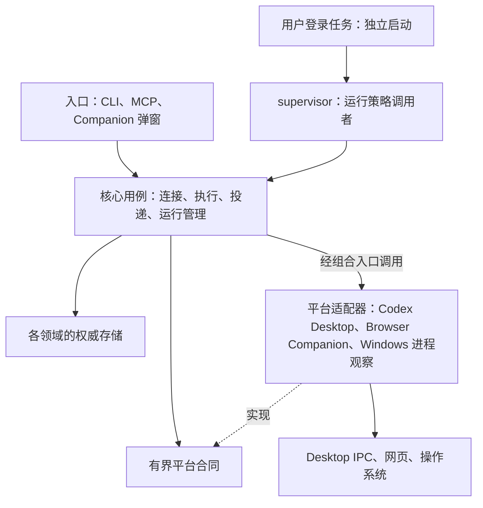

# 核心与插件职责边界

2026-10-05 的职责增量见 [双向消息收件箱](agent-mailbox.md)：Routing 负责持久接收和排队，既有安全 sender 负责真实投递，Result Bus 负责 canonical 结果，Companion 保存逐条 DOM attempt 证据。busy 不拒收，单条 unknown 可隔离；所有权和原请求防重放仍核验。当前为未部署源码开发，下方部署事实是此前阶段记录。

日期：2026-10-04。B0/B1/B2/B4/B5 对应源码已落地，B3 已评估并决定不迁移 SQLite；安装、扩展现场验收与未完成场景以 [开发计划当前事实](development-plan.md#当前事实与开发阶段2026-10-04-2144asiashanghai) 为唯一快照。Supervisor foundation 随 Core 部署，但真实 Scheduled Task 尚未注册。

第1–9节描述设计约束及已采纳边界；第10–15节保留各轮实施和现场证据，后续完成状态覆盖其中当轮“未部署/待验证”的表述。[现有架构](architecture.md)说明主链，[R5 endpoint 合同](r5-endpoint-architecture.md)说明协议。未实施的数据库迁移或后续生命周期场景不能因设计文字视为完成。

## 1. 目标与已有基础

用户选择项目、连接当前对话，并通过明确开关控制结果回流。后台状态可解释，故障影响范围与其实际权威范围一致。连接查询不负责清理全部历史，执行完成与结果送达分别记录，进程操作共用同一判断。

保留现有 workspace 隔离、固定插件注册表、Executor/Web Sink 合同、Result Bus、稳定 launcher、不可变 release 和安全启动协议。核心已经拥有 endpoint binding；本次并非重新实现这些能力。主要收敛重复状态推进、查询中的维护副作用，以及平台观察与运行决策之间的边界。

重构前的动机（对应 B1/B2 已实施变化见第10、11节）：

- `src/mcp/feedback.ts` 的 `feedback_status`、enable/takeover 调用 `reconcileFeedbackOutbox`；后者在 `src/feedback/projector.ts` 恢复 cleanup、收集多类历史 commandId 并取得对应锁。历史损坏锁因此可能阻断连接状态读取。
- `src/process/helper/daemon_spawn.py` 在 HANDLE 等待返回 `WAIT_TIMEOUT` 后，仍可因 exit code 不为 `STILL_ACTIVE` 返回 `PID_EXITED`。本轮现场出现相同创建身份、exit code=1、exit time=0、HANDLE 未 signaled 的组合。该组合不得被上层当作已证明退出；本设计不推断 Windows 卡住的底层原因。
- 新 canonical delivery 已有 Result Bus，但 legacy 投影/兼容路径仍需明确退出条件，不能让多个可写兼容投影共同决定当前可用性。

上述是设计依据和已保存的历史观察，不是持续更新的机器状态。

## 2. 三层结构与依赖方向



这是代码职责图，不要求为每个模块增加进程或服务。保留每工作区 Bridge；supervisor 独立于 Codex 启动。通用核心面向已有合同，具体实现只在固定组合入口注册。Windows 平台实现属于受控内部适配，不增加动态第三方插件加载能力。

| 层 | 应负责 | 不得承担 |
| --- | --- | --- |
| 用户入口 | 参数解析、调用者上下文、展示状态/下一步、发起明确用例 | 直接写业务 store、隐式修锁、顺带切换 endpoint 或恢复进程 |
| 核心用例 | workspace/授权校验、绑定修订、命令与投递状态转换、运行决策、事务边界 | 解析网页 DOM、直接拼装 Desktop 私有 IPC、信任未验证的平台回报 |
| 平台适配器 | 平台交互、平台特有身份/安全校验、输出有界证据、必要本地防重放日志 | 自行创建全局 binding/epoch、另起业务任务队列、调用其他插件或清理全工作区历史 |
| 存储实现 | schema、原子提交、并发约束、唯一性与审计记录 | 网络/网页发送、进程启动、绕过用例授权 |

平台证据是输入，核心仍验证其 workspace、目标、attempt、修订与调用权限。存储事务、固定 registry 均不赋予执行权限。远程自然语言仍不能成为任意 shell、文件写入或安全配置变更授权。

## 3. 状态所有权

“唯一权威”指每类事实只有一个可推进它的负责人；不是把所有职责塞进一个全局模块。名称是职责映射，先复用现有目录，不为分层批量搬文件或引入空抽象。

| 事实/状态 | 唯一负责方及现有落点 | 其他模块的权限 |
| --- | --- | --- |
| workspace、请求主体、权限 | workspace/auth 核心；`workspace/`、`auth/` | 使用校验后的请求上下文；插件不能自行授予权限 |
| Executor active binding 与 epoch | Executor 控制用例；`executor-control/` | 插件提供候选和校验证据；执行只消费冻结 target |
| Web Sink active binding 与 epoch | Web Sink 控制用例；`web-sink-control/` | 浏览器提供当前页面证据；不能直接改核心 binding |
| 对话主体与 route 验证 | 连接用例统一编排；复用 `feedback/` 的受保护状态原语 | 与 Web Sink binding 含义不同，不直接合并 ID/epoch；切换必须验证二者关联 |
| 命令与执行事实 | 执行用例；`routing/`、`executor-control/dispatch-*` 与 canonical result commit | accepted 仅代表投递被接受；只有可信执行证据能推进终态 |
| canonical 结果待投递队列 | `result-bus/` | 兼容层读取或转换；迁移完成后不得独立决定发送资格 |
| 浏览器发送尝试证据 | Companion 的本地发送日志/route fence；核心消费并校验 | 必须保留跨 popup/worker 重启的不可逆发送证据；不能当作第二个任务队列 |
| desired state 与运行操作 | 运行管理用例；`supervisor/lifecycle.ts`、`process/daemon.ts` | CLI/supervisor/rollout 共用；观察器只报告证据，不自行启动或终止 |
| 安装版本与 release 引用 | `core/` 和稳定 launcher | plugin/连接查询不得发布版本、移除引用或执行 GC |
| 历史维护、行政关闭 | 专用 maintenance 用例；现有 cleanup/abandonment 合同 | 与正常查询/连接分离；不能把行政关闭转换成执行成功 |

## 4. 三条主业务流程

### 4.1 查询与连接

当前 feedback/companion 状态及任务面板查询是纯读取：返回最后提交的状态、证据时间/修订，以及明确的 `unknown` 或局部错误；不 create state、不 reconcile、不 cleanup、不 repair、不 spawn。纯查询不声称刚完成了恢复。

连接流程为：取得当前页面/主体证据 → 核心检查授权与当前目标 → 检查相关 in-flight/unknown → 提交绑定变化 → 按既有协议完成 route 验证。只有 `VERIFIED` 且全部发送门禁满足，才具备 production Send 条件。配对不等于发送授权，回流开关不因读取状态而开启。

takeover 与发送仍需在操作边界 fresh 校验并发修订。不能删除 reconcile 调用后直接信任旧缓存；必须先建立足以证明当前相关 in-flight/unknown 的权威读取。历史问题若可能影响当前目标且无法证明隔离，阻止对应 mutation，同时继续提供只读诊断。

### 4.2 执行与投递

命令身份固定 → 在执行边界冻结目标并持久化意图 → 调用平台适配器 → 校验真实回执/结果 → 提交 canonical result → Result Bus 投递。

任务状态与投递状态分离。保留现有 `queued/reserved/claimed/observed/outcome_unknown` 等安全语义，不为减少枚举而合并不可逆边界。外部动作采用“短事务提交意图 → 释放事务 → 外部动作 → 短事务记录证据”；不能持数据库写事务等待 IPC、网页或长轮询。

相同 command/attempt 的精确重放必须幂等，冲突必须拒绝。发送已越过不可逆边界但结果未知时不自动重试；晚到的真实证据只能确认原 attempt。数据库原子性不能提供跨网页发送的 exactly-once 保证。

### 4.3 维护与故障隔离

维护从明确事件或有界后台批次触发，使用现有受审查的所有权/锁协议。查询不承担维护，普通连接不等待全历史扫描。维护预算、游标和失败范围可观察；单条坏记录不能被自动删除、忽略或伪装为完成。

只在证明问题属于某条历史命令且不影响当前权威时隔离该项；若 workspace 身份、存储完整性或共享权威损坏，相关写入仍 fail closed。跨工作区状态与运行时继续隔离。后台维护不自动执行 Abandon、Retire、未知 owner 抢占或 live GC apply。

## 5. 统一运行管理

复用稳定 launcher、maintenance/start/startup-lease 和既有 `ensureBridgeAndTunnel`，由一个逻辑运行管理入口编排 start/stop/restart/rollout。supervisor 只读取 desired state 并调用该入口，不创造第二套启动协议。

观察合同分别保留：精确进程身份、OS 存活/退出证据、应用响应、监听/连接情况和 observedAt。由一处决策代码派生健康、停止中、已停止或无法确认；上层不得通过 PID 存在、端口关闭、shutdown ACK 或 exit code 单独重建判定。

Windows 的存活 HANDLE 尚未 signaled 时，exit code 的变化不能单独证明完成退出。身份不存在的结论仍需要精确 missing 证据；PID 复用、权限失败与证据矛盾属于 unknown。额外线程/驱动停滞原因需独立诊断，不能用 kill tree 掩盖。

- desired=stopped：禁止自动拉起；显式 stop 先持久化意图，失败则不执行关闭。
- desired=running 且健康：复用；正向证明 stopped 才可恢复；unknown 仅报告并有界退避。
- restart 表达 running 并保留 tunnel 偏好；rollout 不改用户 desired state，不移动绑定。
- 优雅关闭各阶段有界并返回阶段证据；达到预算表示尚未完成，不能宣称已退出。
- 精确终止仍是有明确授权的异常恢复，须绑定 PID/创建时间/executable/release 和同一个 HANDLE；不是默认 watchdog 行为。
- Windows 用户登录 Scheduled Task 是选定的独立启动方式，沿用 InteractiveToken/LeastPrivilege/稳定 launcher。真实注册和 reboot/logon/Codex-close 验收单独执行。
- supervisor 运行旧 immutable code 时必须保留准确 release pin；GC 不能凭应用无响应或不可靠退出分类移除该 pin。

## 6. 存储收敛决策

B3 隔离评估已完成：SQLite 的事务中断回滚、写竞争、读快照及备份验证通过；**本轮决定不引入数据库迁移**。内置 `node:sqlite` 从 Node 22.5 才提供，项目仍支持 Node >=20；改用原生扩展将增加安装依赖，且不能替代外部发送 journal、机器维护与进程 lease。尚无减少实际权威/锁协议的迁移证据，因此保留现有领域存储。详见第12.3节与 [Node SQLite 文档](https://nodejs.org/api/sqlite.html)、[SQLite 原子提交说明](https://www.sqlite.org/atomiccommit.html)。

选型门禁：Windows/Node >=20 兼容性、安装包成本、断电/进程中断恢复、短事务竞争、owner-only 访问、备份/恢复、完整性错误处理和真实迁移演练。用小型隔离验证决定采用；若没有减少实际状态/锁协议数量，不为换技术迁移。

若未来重新批准迁移，候选设计为每 workspace 独立事务库；机器安装指针、release artifact、凭据/配对秘密、浏览器本地 journal 保持各自安全边界。大输出可继续不可变文件存储，事务只保存引用及校验；发布/孤儿回收必须有独立可证明协议。机器 maintenance 与进程 lease 不因采用 SQLite 自动消失。

迁移以暂停相关写入、校验源身份/摘要、导入并验证、原子切换权威为单位。未知/损坏来源阻止该范围切换。旧文件只读保留，兼容读取不推进第二套状态；禁止长期双写。回退必须覆盖切换后的新事实，不能把已发送 attempt 回退成待发送；无法无损回退时停止相关写入并诊断。

## 7. 分阶段替换与退役条件

| 阶段 | 实施范围 | 必须替换/退役 | 验收与停止条件 |
| --- | --- | --- | --- |
| B0 设计 | 本文件、架构入口、开发计划与 R5 边界衔接 | 分散且冲突的目标设计入口 | 已完成文档；不标记代码/部署完成 |
| B1 进程证据 | 统一 Windows process observation 与运行决策，先覆盖本次矛盾组合 | 调用方把 exit code/端口当退出证明的重复判断 | HANDLE 未 signaled 时零新 spawn；停机后不被守护撤销；daemon/runtime/supervisor/GC/rollout 同证据同结论 |
| B2 查询与连接 | 建立纯读状态投影和 fresh mutation gate；维护移出 status；交付 Companion 只读状态/消息面板 | feedback/companion 查询全历史 reconcile/cleanup 的隐式调用 | 历史单项坏锁下可读当前状态；相关 unknown 仍阻止切换/发送；并发 takeover 不越权；逐条证据可关联 |
| B3 事务存储评估（已完成） | 保留现有存储，不引入 SQLite | 当前无退役或迁移；不得把评估等同于数据库上线 | 仅当具体迁移可减少真实提交协议且通过 Node/Windows/恢复门禁时再评估 |
| B4 投递主链 | canonical Result Bus 与薄平台适配器；迁移 legacy 兼容读取 | 已迁移范围内可独立推进发送状态的旧 outbox/投影入口 | 不重发未知 attempt；原结果/绑定可追溯；每切换一条路径同步禁用旧 writer |
| B5 产品与运行验收 | 在只读面板上接入经授权的逐条操作；统一错误/下一步、独立启动与恢复验收 | 普通界面多套修复入口；被新路径替代的重复编排 | 取消/删除/重试能力门禁；用户停止、睡眠唤醒、Codex 关闭、登录、升级中断、Browser 重启逐项真实验收 |

B1 已落地并随 Core 部署；B2/B4/B5 源码及后续部署证据见第12–15节。Supervisor 的真实注册与自动恢复仍未启用，B5 运行场景尚未全部验收。R5j 性能优化继续 deferred，不作为当前下一步。

每一代码切片先定向验证，再按项目门禁执行 typecheck/build/diff 与必要串行正式回归；Python helper 改动同时执行对应协议测试。纯文档不重跑代码门禁。不得把“旧源码通过过全量”当作新实现已通过。

## 8. 可核验的简化与兼容标准

- 查询路径涉及历史 cleanup/reconcile 的次数降为 0；有明确范围的维护用例替代它们。
- 每种业务事实只有一个 writer owner；平台插件保留必要证据日志，不拥有额外业务队列。
- 生产 canonical 投递权威维持一个 Result Bus；兼容视图不授予发送权。
- 进程退出决策只有一个来源；列出迁移前后所有调用方并验证一致。
- 每个切片记录删除/合并的状态、锁协议、重复分支与实际代码量；过渡期增量单列，不预先宣称代码一定减少。
- 保留 workspace/OAuth/本机确认/route VERIFIED/epoch/防重放门禁，以及未知结果不重发的合同。
- 无当前事实支持时不猜测成功；状态必须区分“任务接受”“执行完成”“网页已确认收到”。

本设计不授权现有机器修复、历史删除、绑定切换、Scheduled Task 注册、进程终止、commit/push；这些动作继续使用各自明确授权和现有安全边界。

## 9. Browser Companion 操作面板

2026-10-04 用户补充需求：在浏览器伴侣内看见 Codex 与网页两端是否 busy/可接收，以及每条指令、执行 record 与回流的对应状态；提供基于真实状态的手动取消、删除、重试兜底。**只读面板及受控操作均已实现，尚未部署**。操作能力、授权及限制以第12节为准；未保存原指令正文，因此不能从面板重新下发原任务。

### 9.1 布局与两端状态

popup 首页显示两端概览与待处理数量；“消息与任务”打开 extension 自有管理页，仍属于 Companion，不启动另一个管理服务。管理页消费与 popup 相同的核心只读投影，列表/详情共用组件，不引入一套新业务状态机。

```text
当前项目 / 当前网页对话                  最近检查时间
Codex：忙碌 · 正在执行                   网页：可接收
连接服务：可用                          自动回流：已暂停

消息与任务：进行中 | 需要处理 | 当前可核验记录
指令摘要         到达 Codex      执行/record       返回网页
修复示例问题     已接受          已完成            已观察，待确认
检查示例变更     发送结果待核实  未确认            尚无结果

选中一条 → 时间线 / 原因与证据 / 当前可执行的操作
```

以上是示例布局，不是现场状态。真实页面至少分开显示：

| 区域 | 信息与判定约束 |
| --- | --- |
| Codex 端 | 当前绑定目标；可接收、busy、需本机确认、无 owner、不可达或状态未知；缺失证据不能显示 ready |
| 网页端 | 当前页面是否就是冻结/绑定目标；owner、生成中/空闲、输入框是否有未发送文本、route 验证；逐项合格才可接收结果 |
| 连接服务 | 可达性及故障原因；服务不可达时两端显示“无法确认”，不把旧缓存涂成在线 |
| 自动回流 | 开启/暂停独立显示；暂停不等于网页离线，网页空闲也不等于自动发送已获授权 |

每块带 observedAt/新鲜度和可读原因；只有采集成功才更新时间。busy 表示观察到正在忙，unknown 表示无法判断，二者不能合并。刷新无后台 repair/reconcile 副作用；页面可见时有界轮询、退避、合并并发请求，后台保持既有有界唤醒机制，不新增高频扫描。

### 9.2 每条指令的双向追踪

列表的一行代表一次精确执行身份，详情把“网页下发 → Codex 接受 → 执行证据 → 结果形成 → 网页回流”关联起来。使用 workspaceId、commandId、dispatch generation/deliveryId、iteration、可信 receipt/outputId、eventId/attemptId 与冻结目标等**实际存在的身份**连接；不按相似正文、时间邻近或列表行号猜测对应关系。重试/多 attempt 单独列出，旧 attempt 证据不覆盖。

| 阶段 | 显示与证据要求 |
| --- | --- |
| 发往 Codex | 尚未发送、发送中、已接受、明确拒绝/未送出、结果待核实；accepted 不显示“任务完成” |
| 执行与 record | 已接受但执行未确认、观察到执行中、可信终态 ok/failed/blocked；record 草稿不当作正式回执 |
| 结果回流 | 待回流、已预约、已开始发送、网页已观察但 ACK 待确认、已确认、发送结果待核实、已行政结束等待 |
| 中断/异常 | 标明出问题的阶段、最后确认步骤、原因和建议操作；连接中断不能推导命令未执行或消息未送达 |

“回流成功”需原 attempt 的精确网页观察及核心确认；只有网页看到正文而 ACK 失败时显示中间状态，只能补确认原 attempt。缺失、过期或冲突证据保留未知。详情默认短摘要，展开已有授权的输出；不展示 token、配对密钥、原始 argv/env 或无关会话内容。

### 9.3 手动操作与能力边界

核心按当前精确身份、修订、权限和证据返回允许的操作及禁用原因；点击后服务端 fresh revalidate，不能相信 UI 先前的判断。操作超时显示“结果待核实”，再次查询同一 operation identity，不自动再执行。界面不可直接改文件、清锁或用命令行字符串充当后门。

| 用户操作 | 生效范围与约束 |
| --- | --- |
| 取消待发 | 只允许核心证明未进入外部发送/执行边界的项；与开始发送原子互斥，成功后才显示已取消。单纯 release reservation 会回到队列，不能冒充永久取消 |
| 请求停止执行 | 仅在平台适配器具有受支持的精确任务停止能力且调用者授权成立时提供；请求被接受不等于任务已停止，不调用 Bridge/process kill 代替 |
| 删除本地任务数据 | 使用精确 preview/confirm 和现有 cleanup 所有权门禁；明确只删本地记录，不撤销外部执行、不删除网页消息、不代表成功，也不赋予重发权。活动 writer/未知身份仍可拒绝 |
| 重试未送出的发送 | 仅在核心能正向证明原动作未跨不可逆边界、目标/授权仍有效且现有协议允许时提供；沿受支持的幂等机制，不通过换 commandId/清 journal 绕过未知状态 |
| 查看/核实未知结果 | 读取原 attempt 的真实证据；已开始发送但未知时禁用重发。存在 exact late-positive 时只补原确认 |
| 行政结束等待 | 仅既有协议支持、精确目标符合条件且获得该项明确授权时提供；保留行政语义，不伪装为取消成功、ACK 或任务完成 |

Companion 当前凭据不天然拥有 Desktop 取消、任意 cleanup/abandonment 或本机管理权限。所需的受限操作 API、scope、本机确认和 preview/confirm 必须在实现阶段独立审查；不导出 admin token，不因增加按钮扩大权限。暂不支持的能力显示原因和已有安全处理入口，不给出无效的“强制重试”。

### 9.4 保留策略与实施顺序

用户已明确**不需要长期保留**。用户随后明确需要看到全部任务与历史残留：面板展示当前项目仍存在的全部任务、旧对话投递、待处理异常、清理/锁残留和仍可核验的记录，正常 ACK 后沿用 R5h 清理 command-scoped record/output；不新增持久化历史库、长期摘要或永久 commandId registry，不恢复已删除 records。

当前打开的页面可以短暂呈现刚确认的完成状态；关闭/刷新后不恢复已清理项，记录消失本身不证明“回流成功”。未完成或结果未知的项继续按现有安全合同保留必要证据，直到正常收敛或获得精确授权的行政处理，不因显示期限自动删除。本轮按该保留边界交付只读列表，不改变现役清理协议。

实施拆分：B2 先交付两端状态、消息关联与时间线的只读版本，不依赖 SQLite；之后逐项接入已有安全能力。B5 完成普通操作界面与真实验收，调试探针/内部状态放到独立高级诊断，正常使用不要求理解内部协议。

验收覆盖：Codex busy 而网页空闲；网页生成中/输入框非空；页面与绑定目标不同；Bridge 不可达与缓存过期；accepted 无 record；可信结果已生成但回流暂停；网页已观察而 ACK 丢失；发送未知禁止重试；取消与发送竞争；双击操作幂等；删除不影响 peer command 或复活旧消息；现役自动清理后不伪造历史。普通页面只读打开必须零发送、零执行、零 cleanup。


## 10. B1 首个实现切片：进程退出证据（2026-10-04）

本地用户要求继续后，先落实运行安全边界。此次是源码/测试变更，不是现场恢复或部署；Browser Companion GUI 仍按第9节在 B2 实施。

### 10.1 一个退出结论与调用链

- Windows helper 从同一个不可继承 HANDLE 读取身份和等待结果。只有 `WAIT_OBJECT_0` 才证明该 HANDLE 已退出；`OpenProcess` 明确报告 PID 不存在也可归为 missing。已提供 expected creation 时，身份缺失/不符优先 unknown，不能凭另一身份的 signaled HANDLE 回收旧 lease。
- `WAIT_TIMEOUT` 配合 exit code 0/1/其他非259仍为 unknown；访问拒绝、等待失败、协议损坏保持 unknown。exit code 不再单独产生 `PID_EXITED`。[Windows 等待语义](https://learn.microsoft.com/en-us/windows/win32/api/synchapi/nf-synchapi-waitforsingleobject)与[异步终止说明](https://learn.microsoft.com/en-us/windows/win32/api/processthreadsapi/nf-processthreadsapi-terminateprocess)是该规则的依据。
- `process/process-probe.ts` 提供共享 `observeProcessPresence` / `isProcessProvenMissing`。Node signal 0 的肯定结果仅是存在提示；Windows ESRCH 需要上述 native probe 再确认。POSIX ESRCH 保持原有语义。未知、权限失败、超时不会降级为 missing。
- runtime、daemon 启动等待/重启使用共享 presence；supervisor recovery、runtime prune、rollout 复用 runtime 决策；supervisor lease 与行政 repair owner reclaim 共用严格 missing 分类并保留原有 exact identity、二次复核和 maintenance 边界。普通 command/maintenance 等既有同步锁协议没有改写，也没有放宽 corrupt lock 回收。

### 10.2 关闭 ACK、runtime 和 release 引用

`stopBridge` 的 true 只表示认证 shutdown 已接受，CLI 也据此报告“已接受关闭请求”。进程退出路径（SIGINT/SIGTERM/admin/restart/rollout）关闭监听后保留原 runtime 文件，避免 supervisor 看到文件缺失而早启，也避免 GC 丢失仍执行代码的 release 引用。嵌入式 server 的显式 `close()` 仍只关闭实例并按原合同清理其 runtime；它不代表 OS 进程退出。

重启即使面对会提前删除 runtime 的 legacy server，也必须再次证明原 PID 已退出才调用现有 ensure/start 权威。原进程仍存在或未知则有界等待/拒绝；不使用 PID kill，不新增终止或启动协议。原 runtime 由后续受门禁保护的启动替换；若工作区持续保持 stopped，现代 runtime 的精确 release pin 暂时保留，未新增自动 prune/回收协议。这是明确的保守保留成本，不把停止请求当作 GC 授权。

### 10.3 验证与后续

定向验证最终为 **15 files / 446 tests PASS**；Python daemon protocol **20/20**、Desktop protocol **89/89**、daemon teardown **13/13**、typecheck 与 git diff --check 通过。唯一正式 `pnpm test --maxWorkers=1 --testTimeout=90000` 为 **158 files / 3243 tests 全 PASS、exit0、unhandled0**，wall **1621.59s** / runner **1616.95s**；无 skipped/pending/retry。445 个源码/测试/support 冻结 hash 稳定；归属/歧义进程、listener、新 test-tmp 目录均0（全局新增进程亦0），supervisor-store 最长单项 **37.21s**，无 onTaskUpdate timeout。全量后一次 canonical build，stored == computeBuildId == core-release.buildId == **`6e18fd3ebde732847590a7420a3e81157e2c46c28115b1e5ce58ff2edad71aba`**，build 后冻结 hash 仍稳定。R5j 仅更新 exact count/hash bookkeeping，仍 experimental/deferred、workers3；没有运行 candidate 或优化实验。证据：ignored `.tooling/b1-process-exit/{focused-summary,full-result,build-identity,changes}.json` 与 `changes.patch`。源码/构建通过不代表部署或现场连接已恢复。

保留现有 desired-state、named tunnel、Desktop/Feedback/Web Sink/Executor binding、route fence 和记录合同。此次未操作真实 Bridge、Scheduled Task、历史锁、绑定或 GC apply。统一运行管理器的其余用例收敛与现场恢复验收仍待后续审查；B2 只读 GUI 无需等待数据库迁移，且不增长期历史存储。


## 11. B2 首个实现切片：只读状态与项目任务面板（2026-10-04）

最新用户要求：面板显示**当前项目的全部任务，包括之前残留的异常消息**，用于核对遗留债务；不需要长期存储。此范围覆盖仍在本机持久化的数据，不等于恢复已删除历史，也不扩大到其他 workspace。

### 11.1 查询与维护分离

- `feedback_status` / `feedback_companion_status` 从严格状态读取器投影，annotations 标记 readOnly；缺失状态返回 disabled/空投影，不建立 cursor、不申请 lifecycle 锁、不 reconcile/cleanup/stale recovery。损坏状态仍报错。
- popup 的 `c2c.status.request` 改走 `c2c.status.read`，只校验实际 document/route 并返回观察，不推进 Connect、route bind、自动 Send、journal 或 owner 状态。
- 新 `GET /api/companion/v1/operations` 是独立的零写入投影，`Cache-Control: no-store`。服务端固定 workspace；要求当前有效 Companion、VERIFIED route 及 exact active receiver binding/epoch/principal，IPC await 后再次核验。superseded/旧 receiver 无权查看项目历史。
- 本节记录首个 B2 切片的历史边界；后续第12节已将 `/state` 改为纯读，并把连接 enable/takeover/pair 与历史维护解耦。claim/reserve/begin-send/ack 继续保留各自 fresh mutation gates。

### 11.2 项目级元数据与 GUI

核心聚合 Routing command/canonical result、Desktop accepted/rejected/outcome_unknown、可信 receipt 元数据、Result Bus/Feedback、行政结束证据和 command-cleanup 残留。以真实 commandId / iteration / resultId / eventId / attemptId 关联；同名但身份不符的 delivery 标明冲突。历史无 Routing 的 Desktop 投递、孤立空锁也有独立行，空锁存在不证明 owner 死亡，不触发回收。

列表显示全部任务、进行中、需要处理、历史遗留；支持 commandId 搜索、每页100条（客户端分页，不丢弃100条后的历史）。详情显示下发、执行 record、回流和有界原因；行政 abandonment/retirement/resolution 保持“行政结束等待”含义，不冒充成功。项目级历史仅返回状态与标识，不返回旧会话消息正文、输出正文、principal、credential、原始 argv/env 或文件路径。首版的只读限制已由第12节逐条受控操作扩展；不支持的操作显示具体原因。

Executor 插件为已有 inspectSession 增加可选 activity；Codex adapter 复用现有 IPC runtimeStatus/requestsCount，不增加启动/停止权威。缺失或变化的身份显示 unknown。网页端复用既有精确 owner 的 heartbeat 观察；45s过期显示无法确认。服务不可达时两端不沿用绿色在线状态；自动回流暂停单独显示。列表数据只存在页面内存，关闭不持久化历史；正常 R5h 清理后不恢复。

扩展仅自有 popup/管理页可发 `c2c.operations.read`；content script 不可请求项目级历史。worker 合并并发 GET，响应必须仍属于原 transport/auth revision，查询不回写 auth/transport/journal。管理页可见时30s刷新，失败退避至120s，隐藏时停止轮询。现有 Grant Bridge access、Pair、route fence 与 Send 权限不变，无新 permission/依赖。

### 11.3 验证与部署边界

定向验证 **16 files / 589 tests PASS**，typecheck 与 git diff --check 通过。隔离 Edge fixture 检查桌面/窄屏布局、历史筛选、详情、搜索，截图证据确认零 Send；这是模拟数据检查，没有连接生产 Bridge 或 reload 扩展。修订旧合同断言后重新冻结的正式门禁 `pnpm test --maxWorkers=1 --testTimeout=90000` 为 **159 files / 3274 tests 全 PASS、exit0、unhandled0**，wall **1661.47s** / runner **1657.17s**；无 skipped/pending/retry。452 个源码/测试/support 冻结 hash 稳定，归属/歧义进程、listener、新 test-tmp 目录均0；全局新增测试能力进程0（其中已证明无关0）。supervisor-store 最长单项 **35.84s**，无 onTaskUpdate timeout。全量后一次 canonical build，stored == computeBuildId == core-release.buildId == **`ac300c18dbdeb3d98e007645de2b7a16a46dbb5ba56c5157e987048c05037dfe`**，build 后冻结 hash 仍稳定。现存 route.js.map sourcemap 警告在 B1 门禁已存在，不计为新增或 unhandled error。

首次全量为159 files /3274 tests，其中3273通过、1项旧测试失败（MCP integration仍要求6处reconcile调用，纯读迁移后实际4处）。仅修订该静态断言为精确四个 mutation 入口及对应 manifest hash，定向3 files /56 tests通过；生产源码不变。首次失败及第二轮正式结果分别保留在根目录与 `gate-2/`，未使用 retry、repeat 或 timeout 放宽。

本轮相对起点共31个文件变更（7个新增）；已有 dirty R5/B1 字节保持，HEAD 不变、暂存/冲突为空。证据位于 ignored `.tooling/b2-readonly-panel/{focused-summary,full-result,build-identity,changes,preview-check}.json`、`changes.patch`、`panel-preview.png` 与 `panel-history-mobile.png`；最终正式证据在 `gate-2/{frozen,full-result}.json`。此次仅源码、测试、文档及 ignored 证据；未安装/Reload Companion、未 rollout/恢复真实 Bridge、未修改真实历史锁/绑定/任务，也未注册 Scheduled Task。R5j 仅更新 exact159/3274、packaging1/serial6/parallel152、support32 的 manifest bookkeeping，仍 experimental、workers3；未执行候选/并行实验。

## 12. B2–B5 剩余源码交付（2026-10-04）

本节覆盖随后本地用户授权的开发，不是 C2C 历史命令回执或机器部署记录。

### 12.1 只读查询、连接与后台维护

`feedback_status`、`feedback_companion_status`、Companion `GET /state`、`GET /operations`、`GET /operations/result` 只读现有权威。`/state` 不再 reconcile、恢复 stale、推进投影或创建 terminal witness key；损坏/缺失必要权威返回明确错误。ready 数是当前 durable queued 数，不保证某条 command 的写锁可取得；reserve 仍 fresh 校验。

连接 enable/takeover/pair/rebind 统一经 `bridge/connection.ts`：delivery arbiter → strict 领域状态核验 → binding store。receiver enable/takeover 保留 Bus in-flight fence；Companion pair/rebind 只改变凭据，不拥有 canonical Bus，允许保留已有冻结目标继续完成原 attempt，不能偷换它的 Sink。legacy Feedback 的 reserved/claimed/outcome_unknown 即使超时也仍阻止相关身份变化，不能靠查询或连接隐式消除。连接不再取得无关历史命令锁；初始化仅显式记录当前 record baseline。

生产 Bridge 每30秒执行一次同步、有界 `bridge/maintenance.ts` 批次；shutdown 取消定时器，不增加进程或新服务。清理最多10条、canonical 投影最多25条并轮转，legacy 投影按 cursor 最多25条记录/告警，cutover 每批最多25条 disposition。只恢复已获既有协议授权的 cleanup/stale/projection；不执行 Send、重发、Abandon、Retire、修锁或 GC。普通查询完全不承担这些任务。

锁顺序保持 delivery arbiter → command lifecycle → cleanup workspace（仅清理）/endpoint switch（仅预约重排）→ store；没有持有较低层 store 锁再取得 arbiter 的入口。corrupt command authority 仍阻止该 command；canonical 批次隔离有明确 commandId 的 BUSY/IN_PROGRESS，后续批次继续其余项。共享存储/身份损坏中止本批次。legacy cursor 前的受阻项保守阻止该 legacy 批次，不跳过未知事实。

既有 delivery arbiter/endpoint 锁若留下无法确认的残留，相关写入仍 BUSY；本轮不新增按年龄删除或通用抢锁。状态查询不申请这些锁，仍可展示故障；进程级崩溃导致的锁处置继续需要本机精确核验，不能把面板操作记录的 reconciliation 扩大为修锁权限。

### 12.2 canonical 主链与任务面板操作

新 canonical result 仍只进入 Result Bus；legacy 投影不为 routed canonical result 建第二个可发送事件。兼容转换仅保留未迁移的真实旧记录及 final-receipt 告警。退役的是查询/连接隐式推进历史的调用路径，不强删尚有历史权威的兼容协议。后台会恢复已有事务，GUI 刷新不会改变队列。

GUI 聚合本 workspace 全部存续 command、Desktop delivery、dispatch-only 记录、可信 record、Result Bus/Feedback 及孤立 cleanup 证据；旧对话与异常消息不会因当前 binding 改变而隐藏。没有数据来源的已删除历史不重建。端点状态/时间线保持独立，accepted 不等于执行完成，record 不等于网页收到。

| 操作 | 可执行条件与效果 |
| --- | --- |
| 取消尚未下发指令 | Routing pending，且无 Desktop/dispatch/record/result/Bus/Feedback 证据；标记 rejected + cancelledAt，保留防重放事实，Desktop 和 generic dispatch 在外部调用前拒绝再投递 |
| 取消结果回流 | 唯一 canonical queued 事件；标记 cancelled，保留结果，不制造 ACK、不撤回已执行工作 |
| 重新排队回流 | reserved 且精确当前 Web Sink stamp/route；endpoint switch fence 下释放原 reservation，未进入 begin-send；不直接点击 Send |
| 清理本地记录 | 既有精确 cleanup preview/confirm；无 in-flight/unknown/执行中事实，accepted 需可信终态或已获原行政协议关闭；仅清理该 command 的运行数据/输出 |
| 核验中断操作 | 只读查 requestId；必要时显式 reconciliation 仅证明原请求的本地目标状态并完成元数据，不再次执行请求 |
| 重发原指令/终止执行/修 corrupt lock | 不支持直接点击执行。面板未保存原文；已接受/unknown 不能猜作未发。精确行政处置继续使用本机原协议，不新增 force 按钮 |

操作默认关闭。先在本机运行 `c2c operations authorize -w <workspace> --companion-id <当前 ID> --local-user`（默认15分钟，允许1–60分钟），只授权当前 VERIFIED Companion 的 exact binding/epoch/route；`operations status` 只读，`operations revoke --local-user` 撤销。配对、OAuth、网页自然语言或发现面板都不自动授予清理权限。用户在 popup 暂停自动回流后，逐条预览范围/影响，勾选确认。GUI 不导出机器凭据、不接收任意路径或通配目标。

扩展仅自己的 operations 页面可发 action RPC；content script 和伪造 sender 拒绝。服务端重新验证 credential、当前 receiver/principal、workspace、授权有效期、requestId 与绑定全部 evidence 的 SHA256。预览零写；confirm 先 durable pending，再调用领域操作，再写 completed。精确重放不再执行。transport/auth revision 漂移或响应丢失保留 pending；同 workspace + command 禁止换 ID 重试，其他 command 仍可处理；扩展 pending/completed 日志按 workspaceId 隔离，同名 commandId/requestId 不跨项目相互清除或阻断。缺失 workspace 身份的旧/损坏本地操作日志保留并拒绝写入。浏览器 journal 未解决时拒绝手动写操作，唯一例外为同 event 的 RESERVED 释放。

中断后仅在域证据证明取消标记/原 reservation 已退出/精确 cleanup 已完成时收敛；无法证明保持 pending。completed 元数据在新操作时淘汰一小时前记录，核心总量100；未决记录不按年龄清除。扩展保留全部 pending 与最近20个终态（硬上限100），不存任务原文或长期任务历史。操作日志不是第二条投递队列；清理本地数据不授权重发。

取消门禁兼容旧 Desktop 路径：Routing 尚未建立时不创建它，也不引入其 canonical identity 前置条件；已有 Routing 权威则严格校验，取消过的命令仍在原 command lifecycle fence 内拒绝外部发送。

兼容说明：旧持久化记录可直接读取；新增 panel 元数据、cancelledAt 与 cancelled 终态只有新版本理解。面板授权/写操作必须使用本轮构建对应的 CLI、Bridge 和 Companion；旧版本遇到新字段应拒绝解析，不能清除证据强行降级。部署先升级运行的 Bridge，再启用面板操作；回退须保留新事实并采用能理解这些字段的版本，不能仅切回旧二进制。

### 12.3 B3 评估结论与剩余现场验收

隔离 SQLite 3.50.4 原型验证 WAL/FULL 提交、子进程在未提交事务中退出后的回滚、竞争 writer 拒绝、reader snapshot、备份还原和 integrity_check；临时数据库清理完成。该原型没有证明生产 Windows ACL、Node 20 驱动部署或跨旧 store 无损迁移，也不能使网页发送与数据库同事务。因此本轮不引入 SQLite、不添加依赖、不提高 Node 下限；仅在具体领域迁移能删掉既有多文件提交协议且通过全部门禁后重新评估。

没有为层次感批量搬目录，没有新增插件注册机制。保留 B1 精确进程/运行决策与所有旧安全边界。本轮生产源码的逐文件增删统计保存在 ignored `change-size.json`（包含6个新增模块；不计测试、文档和实验清单）。GUI/授权/维护带来增量；减少的是查询与连接中的隐式维护调用，不宣称总行数已下降。

第12.3节记录源码交付时的边界：当轮未执行真实安装或运行操作。后续安装、Companion reload、Bridge 恢复/rollout 与连接现场验收已见第12.6–15节；尚待 supervisor 注册及 reboot/logon/Codex-close、睡眠恢复、升级中断等剩余场景。源码测试不能替代现场验收。

### 12.4 验证证据

定向验证 **21 files / 765 tests PASS**，typecheck 与 git diff --check 通过。最终正式 `pnpm test --maxWorkers=1 --testTimeout=90000` 为 **159 files /3307 tests 全 PASS、exit0、unhandled0**，wall **1635.19s** / runner **1630.80s**；无 skipped/pending/retry。458 个源码/测试/support hash 在 full 前后稳定；归属/歧义进程与 listener、新 test-tmp 目录均0。全局新增测试能力进程 0，其中已证明无关 0。supervisor-store 最长单项 **38.88s**，无 onTaskUpdate timeout。

正式全量后一次 canonical build，stored == computeBuildId == core-release.buildId == **`ba5fd48e1c8ae8f39f5492defd8270ef6148151765fa3e750a4f5a69fb891e61`**，任务面板静态文件与对应源码逐字节一致，新模块均包含在产物中；build 后冻结 hash 再次核验稳定。现存 route.js.map sourcemap 警告不是新增或 unhandled error。此次只产生源码构建，不代表 installed/running runtime 已更新。

首次全量证据保留于 `gate/`：159 files /3305 tests 中3241通过、64失败、3个 unhandled rejection，exit1。原因是新增取消 guard 对尚无 Routing 的旧 Desktop 路径强加身份依赖、Companion pairing 误用 receiver 的 Bus in-flight gate，以及旧枚举断言遗漏 cancelled。已修复前两处过宽门禁、精确补齐枚举合同，并修复独立复现的跨工作区同名 command/requestId 操作日志冲突；7套件202项及最终2套件69项定向通过后，重新冻结再跑本节最终门禁。没有放宽权限、时间窗或重试策略。

首次失败留下的 `.tooling/test-tmp/state-a90f05a2` 保留用于诊断，未删除它来制造通过；最终门禁以其为既存基线，新增残留为0。不能把本节表述为整个任务从未留下临时目录。

相对本轮起点共 44 个文件变更，其中6个新模块；已有 dirty R5/B1/B2 工作与无关文件字节保持，HEAD 不变，暂存/冲突为空。ignored证据位于 `.tooling/boundary-completion/`：`focused-summary.json`、`gate-2/{frozen,full-result}.json`、`build-identity.json`、`changes.json`、`changes.patch`、`change-size.json` 与 `sqlite-evaluation.json`。本轮没有修改 Python helper，也未执行 live 安装、Bridge 恢复、浏览器发送、历史锁修复、Scheduled Task、commit/push。

候选清单只刷新本轮审阅过的 test/support hash 与 expectedTests=3307：159文件、packaging1/serial6/parallel152、support32；official test仍 `vitest run`，实验workers3不变，R5j deferred。未运行 candidate/parallel/worker 实验，也没有 promotion 结论。

隔离浏览器视觉检查未完成：Edge 启动 EACCES，computer-use 资源初始化失败（os error 3）。脚本解析、view model、发送者/授权/确认与崩溃恢复逻辑由定向测试覆盖；不把这当作真实浏览器验收。证据保存在 ignored `.tooling/boundary-completion/`，保留所有首次失败日志；不使用 retry、repeat 或 timeout 放宽。


### 12.5 本地用户部署请求：已安装，运行启用受阻（2026-10-04 17:56）

用户在源码交付后明确要求部署。部署前重新验证458个冻结hash、无暂存/冲突和三方build身份；不重复已经通过的full/typecheck/build。通过canonical `scripts/install-core.mjs`安装 **`ba5fd48e1c8ae8f39f5492defd8270ef6148151765fa3e750a4f5a69fb891e61`**，稳定launcher已指向该不可变release；完整artifact/bootstrap校验、关键helper/daemon/面板模块逐字节比较通过，Skill同步为源模板替换唯一稳定入口后的精确内容。此前源码阶段的“未部署”仅为当时快照。

仅对workspace2582910bf0d2执行已安装launcher的rollout，结果 **upgraded0 / pending1 / error0，reason=runtime_unknown**。durable runtime仍引用旧build `8e1553735dc817e60d758d8ffb156c41a2758d70562995470f09e1803e2eebce`；PID16188、creation134355028686992076在新只读HANDLE上仍为WAIT_TIMEOUT(258)、exitCode1、exitTime0。没有把exitCode1当作进程已经退出，没有再次TerminateProcess或启动新Bridge。local/admin未获得有效响应，named health三次返回HTTP530；不宣称新版本正在运行或连接恢复。

四类binding store、当前runtime文件、其他workspace runtime的字节/文件身份保持；supervisor status前后task absent、config/runtime null，未创建目录或launch pin。安装内置auto-GC删除0、tombstone0、bytes0；仅保留已知runtime:d94af68105aa dangling局部告警，无global blocker。rollout更新pending后最终只读GC计划保留旧8e运行引用与新ba5 current/pending；旧b6成为候选72,343,792 bytes，未追加apply。

Browser Companion新产物已就绪，自动化入口仍报`failed to write kernel assets (os error 3)`，因此未Reload扩展，未做网页发送或绑定修改。下一步需用户保存工作并重启Windows；之后重新核验旧身份消失，再沿稳定launcher为同workspace恢复原named连接并核验健康，最后Reload扩展。没有发起系统重启、Scheduled Task变更、历史清理、rebind或commit/push。原始证据在ignored `.tooling/boundary-deploy/closeout.json`及同目录；本次是普通本地部署请求，不写C2C历史receipt。


### 12.6 重启后恢复部署与原会话确认（2026-10-04 19:24）

用户重启 Windows 后要求继续部署。只读启动时间为北京时间18:32:24.5；原PID16188/creation134355028686992076现为精确 missing（WIN32_87），Bridge observation=stopped/pid_missing。458个冻结源码/测试/support hash及三方build保持前轮正式门禁结果；没有重跑full/typecheck/build，没有再次安装。

通过已安装稳定launcher执行本工作区 `start --tunnel`，新Bridge PID10400、creation134355859361048193、startedAt=2026-10-04T11:12:17.534Z。built == installed == running == `ba5fd48e1c8ae8f39f5492defd8270ef6148151765fa3e750a4f5a69fb891e61`，Node executable与不可变release entry精确匹配，spawn provenance=matching。local health、authenticated admin、固定named health均返回同一运行身份，named一次成功，原`https://c2c-codex-with-chatgpt.devworklink.com`地址保持。scoped rollout同版本短路返回current1/upgraded0/pending0/error0，仅清除旧pending，不再次重启。

重启使Desktop/app-server精确身份变化，初始status为DESKTOP_PROCESS_CHANGED。先只读证明当前thread/project/workspace均为原目标，再按本机disable→bind-current确认流程刷新runtimeFence；第一次确认未完成，用户明确要求再次显示后确认成功。thread `01a101c3-9904-71f1-8d9d-78550f40fa35` 与bindingId `3e866dc6-8c9c-41a8-9afe-861e6dacf899`保持，最终enabled=true/available=true/unresolvedDelivery=false。四类binding内容hash与原Desktop deliveries不变；变动仅为正常授权revision/enabled及经确认的Desktop runtimeFence，未创建新投递目标或伪造回执。

Feedback/Result Bus的reserved/claimed/outcome_unknown均0，但这不表示历史清空：Feedback仍queued1，Bus仍queued50；未发送、重发或清理它们。旧网页route与verified证据保留，不据旧attestation断言当前浏览器document仍为owner。面板写操作授权仍关闭，pending panel operations0。其他workspace runtime字节/文件身份不变；maintenance/rollout/start locks无残留。supervisor status只读返回task absent、config/runtime null，目录仍不存在，没有注册任务或启动supervisor。

最终只读GC计划：当前ba5 release由current/runtime保护，旧8e与b6为候选，合计144,440,182 bytes，未apply。保留已知runtime:d94af68105aa dangling局部问题；global blocker0/local issue1，因此GC计划CLI按degraded返回非零，不将其误报为全绿，也不删除该authority。新进程inAnyJob=true、旧shutdown provenance仍conflict，未据本次恢复宣称Codex-close、独立supervisor reboot或新进程shutdown验收通过。

浏览器自动化初始化现已恢复，但仅暴露空的in-app浏览器，实际外部扩展宿主不可操作；用户已明确回复“已重新加载”，随后确认“全部任务”和“历史遗留”列表能正常显示；这是用户现场确认，未声称自动化截图验收或真实Send/ACK通过。没有自动配对、切换网页目标或增加操作授权。此轮只更新这四份部署文档；源码、测试、support冻结不变，不写普通turn无法归属的历史C2C receipt，不做Scheduled Task/额外GC/历史修复/commit/push。证据位于ignored `.tooling/boundary-deploy-resume/`，部署前后的旧证据保留。


## 13. 旧格式残余记录清理（2026-10-04）

用户要求清空本工作区历史；标准逐 command 清理后，旧格式 JSONL 仍可能含重复 commandId、iteration=0/2 或无 commandId 的记录。新增本机 `cleanup legacy-history -w <workspace> --json` 只读预览；携带本次 `--confirm <confirmationSha256>` 才删除。它不扩大普通 `cleanup command` 的唯一记录合同，不通过重写旧记录伪造执行身份。

前置条件是本工作区 Desktop、Routing、Result Bus、Feedback、dispatch、R4 outbox/reconciliation、历史处置证据与 receipt finalizer/command cleanup 均为空。精确摘要涵盖执行文件、输出索引/正文、Feedback 文件的身份及内容；链接、缺失正文/索引、未知正文和快照漂移均拒绝。删除范围为预览中的全部剩余 execution JSONL、输出 body/index items 与相应 projection cursor；保留绑定、配对、路由、其他工作区，以及输出 nextId，避免复用旧 outputId。它不删除 ChatGPT/Codex 对话消息。

锁顺序为 delivery arbiter → 独立 workspace cleanup → execution → output → Feedback。删除前持久化仅含身份/摘要的 journal，随后分阶段校验并删除；pending journal 阻断记录、输出、Feedback writer 和逐条清理。已释放短锁的中断可使用同一摘要继续；进程硬退出留下的既有短锁仍遵守原 fail-closed/manual-review 规则，不按年龄猜测 owner 已退出。损坏 journal、文件替换或未知临时内容保留现场。固定临时文件 fsync 后原子替换索引/游标，完成后才删除 journal。

Feedback projector 在持有 Feedback 锁时复核源记录摘要与游标，拒绝将清理前读到的快照重新投影。清理期间不发送消息、不更换连接、不回填历史 receipt。该入口仅供本机明确授权操作，浏览器面板继续使用逐条能力。

本轮完成证据（2026-10-04，Asia/Shanghai）：新增清理 29 tests PASS；正式串行全量 **160 files /3336 tests PASS**、exit0、unhandled0、无 skipped/pending；runner 1559.41s / wall 1564.64s。461 个源码/测试/支持文件冻结稳定，无新增测试目录及 attributable/ambiguous process/listener residue；typecheck/build/diff check PASS。

已通过标准 installer 安装并仅 rollout 本工作区：built=installed=running=`fb6ac93f47884ff7ea85ac5a9299913c8a6c03e05d3844f990c5c7f677b035a3`，upgraded1/pending0/error0、runtimeUpgrade=current。Bridge PID **12676**，startedAt `2026-10-04T12:23:54.421Z`；local/authenticated admin/named health 通过，原 named URL、Desktop binding/runtimeFence、Feedback pairing、路由及其他工作区配置保留。

用户授权的真实清理已完成：上一轮标准逐条清理移除 396 行任务；本轮清空剩余 **9 行任务 /97 条 execution records /1 份输出**。Desktop、Routing commands/results、Feedback、Bus、dispatch、cutover、outbox/reconciliation 与历史处置证据均为 0；projection cursor=0，output nextId=252 保留。清理前后 18 份受保护状态文件及绑定摘要一致；再次只读 preview 为 not_found/records0/outputs0，没有重新投影。该结果仅指 C2C 本工作区任务记录，不删除网页/Codex 对话消息。

安装器自动 GC 回收无引用的 `8e155373…e2eebce` 与 `b6a25e1c…fd6303f7`，合计 144440182 bytes；另一个工作区 d94af68105aa 原有 dangling runtime reference 保留（global blockers0/local issue1）。最终仅执行只读 GC plan，旧 `ba5fd48e…891e61` 为候选，未额外 apply。supervisor config/runtime=null、Scheduled Task absent，未注册任务。无 rebind/endpoint switch/Browser Send/receipt backfill/commit/push。证据：`.tooling/legacy-history-cleanup-dev/`。

## 14. 新对话接管已完成但扩展未继续（2026-10-04）

现场只读观察（20:41，Asia/Shanghai）：Feedback receiver 已于 20:35 接管至 epoch 12，Companion 和 Web Sink 仍指向 epoch 11 的旧页面，rebindIntent 尚未创建。ChatGPT 回复“接管完成”只证明一个连接阶段；popup 的旧 VERIFIED 不能代表当前页面可回流。浏览器未保留可证明当次 DOM 观察失败原因的诊断，不能据此宣称服务端接管失败。

本轮仅修改 Companion 与回归：显式 Connect 可针对身份完整、challenge=null 的 TAKEOVER_DISPATCH / OUTCOME_UNKNOWN，通过原认证 rebind/init 检查精确 immediate successor，再继续原 route attestation、credential rotation、authenticated state 与 Web Sink 收敛。自举消息不重发；heartbeat/status 不触发该恢复；route-attestation unknown、身份错配、活动/未知 fence、网络不确定或持久化失败继续 fail closed。若新 transport 已 durable 而 flow 更新前中断，只能以同 workspace/目标/下一代身份的 rebindPending transport 继续。未新增后台接口、未弱化配对权限或发送防重放。

popup 分开显示已保存绑定的 VERIFIED、当前页面匹配与完整连接；重开 popup 可看到持久 flow/fence 阶段。接管发送观察不明但可核验时，提示点击连接核验，避免把旧绑定状态说成当前页面已连接。

验证：定向 16 files /744 tests PASS（新增 18 项；随后 popup 刷新另增 2 项），typecheck、canonical build、stored/compute/core 三方 build ID 与 diff 检查通过。新 build 为 cde33c6292df7147eec0c440da6d98abfde0011fac00d2e8393238c43389e216。库存为 160 files /3356 tests；仅刷新变更测试和 runner 数量的 manifest hash，未跑 candidate/parallel，未宣称新全量门禁。旧 3336 正式全量是前一冻结基线。后台生产源码未变，本轮未安装或重启 Bridge；扩展加载 checkout dist/browser-companion，需用户 Reload 后点 Connect 完成现场验收，当前待确认。证据：.tooling/connect-takeover-recovery/。

现场第一次重载后仍被本地检查阻止：原 authenticated VERIFIED 会删除 transport.routeAttestationMessage，新增检查误依赖已正常清除的文本。已增加该真实持久形态的回归，复用精确旧 companion/route 的 durable VERIFIED fence challenge；仍需原服务端 rebind/init 的 immediate-successor 证明。非 VERIFIED/错误 identity/未知 fence 不放行。首次重载并不算连接验收通过；修订版等待再次重载及显式 Connect 结果。

21:05 现场：用户显式 Connect 后，服务端 Companion 切换为 dd2dacf8-721c-42c1-ae94-c832ccd0bdce，epoch 12，当前新 route 的 attestation 在 13:05:10Z verified、rebind 在 13:05:11Z consumed；Web Sink epoch 2 指向同一新 route。旧自举没有重发，Bridge PID 12676/build fb6ac93f 保持不变，local/admin 健康。用户随后 GET /state 成功（队列/in-flight 均 0），但 popup 仍显示发送当时的 ATTEST_REQUESTED 快照：已补可见时每 2 秒串行 local status 只读刷新、隐藏/关闭取消、GET state 后刷新，DONE 时同步清除主区域旧等待提示。没有自动 connect/reserve/send/Bridge repair。此后 popup/browser/manifest 3 files /111 tests PASS，typecheck/build/diff 与三方 ID 复核通过。用户端最终 UI 确认待回报；未发送任务或回流测试消息。

最终现场验收：重载扩展后旧网页通信上下文不可用，用户刷新 ChatGPT 页面后恢复；新 document 按既有权限边界需一次显式 Connect 重新确认 owner，不自动继承。用户随后确认“当前对话已连接，自动回流已开启”。epoch 12/当前 route 及新 Web Sink 保持一致；本轮未发送真实任务或伪造回流测试，因此此处证明连接/验证/界面/自动回流启用状态，不扩张为新任务全链路投递证明。

21:19 本地用户报告任务面板 Codex 端 inspect_failed：只读核验发现 Desktop 已绑定当前 thread 01a101c3-9904-71f1-8d9d-78550f40fa35 且 available=true，而 generic Executor 仍是 10 月 1 日旧 thread 01a0f4a1-9ca9-7083-b0e8-273056aeb3c6（epoch 2）。核验真实 currentIdentity 与现有 Desktop target 完全一致后，通过已安装稳定入口 executor bind-current 对齐；复用 same-target/already-enabled/runtime-fence 精确校验，无额外确认、无手写状态。Executor 更新为当前 thread/epoch 3，fresh inspect available=true/activity=busy（本会话正在处理本轮请求）。Desktop、Feedback、Web Sink、runtime/current 6 个已有文件 hash 前后不变；无源码修改、Bridge 重启或扩展重载。证据 .tooling/executor-panel-alignment/。


## 15. 新页面连接零写入拒绝与错误诊断（2026-10-04）

21:23 只读核验：新页面 6ac252e9-86d0-83ec-b59c-3f0fc8736b79 的本地 flow 为 OUTCOME_UNKNOWN；服务端仍为已验证旧页面 6ac1be8b-9254-83ec-80ee-04735fd860a5 / epoch 12，尚无下一代接管。用户确认新页面无 bootstrap 消息且输入框为空。旧诊断 reason=-，不足以证明原始失败发生在哪个分支，不能把本地未知当成发送成功或证明未发送。

确定复现的代码缺陷：content-script 在 sender 不符或 bootstrap runner 缺失时，零写入拒绝响应缺 type/mode/route/generation；worker 因无法核验响应身份而将其硬化为 OUTCOME_UNKNOWN。修正两处前置拒绝为完整精确文档响应，沿用原有零写入回滚分支；跨层测试直接运行真实 content-script，避免人工 mock 掩盖缺字段。身份漂移、写入/点击不确定及旧未知记录不自动清除、不自动重发。连接按钮结果保留到只读状态，bootstrap 未知原因以有界错误码随原 flow 保存，重开及 worker 重启后可诊断；错误码不参与授权或重试判断。

验证：8 files /502 tests PASS，typecheck、canonical build、三方 build ID 与 git diff --check PASS。仅增强既有测试，库存仍为 160 files /3356 tests，仅刷新两份变更测试 hash；未跑候选/并行或新的正式全量。checkout build=70b189e97b32c73c73ad4cccf80f97db024237f6331bcc3d964ba39decda5bb9；未安装/重启 Bridge，后台仍为 fb6ac93f/PID12676。本轮旧未知 flow 的原始原因无法追溯，修复后实际新页面连接仍待用户重载与受控核验，不宣称现场问题已经解决。证据 .tooling/connect-preflight-recovery/。


21:39 现场验收更新：用户重载扩展并刷新新网页；一次显式 Connect 重新取得当前 document 身份并返回 NOT_SUCCESSOR，随后用户通过既有 Abandon connect unknown 只清除本地旧自举 fence（state=NONE，zeroWrite/zeroClick/zeroBridgeMutation=true）。再次显式 Connect 后出现连接消息，服务端 receiver 正常变为 epoch13；新页面验证于 13:38:59.834Z verified，rebind 于 13:39:04.249Z consumed。最终 Companion 8bbc8000-15c9-4246-a9ed-a5fb04fe6d52 / binding 5dfd77e1-81c3-433b-8f47-0776c3efbebf / epoch13 与新 route 6ac252e9-86d0-83ec-b59c-3f0fc8736b79 一致；Web Sink epoch3 指向同一新 route。用户确认“当前对话已连接，自动回流已开启”。Bridge PID12676/build fb6ac93f 未变，events0；未发送开发任务或结果测试消息。旧失败缺少原始原因，因此本次恢复和已复现缺陷修复不被表述为原始故障分支已被现场证实。
