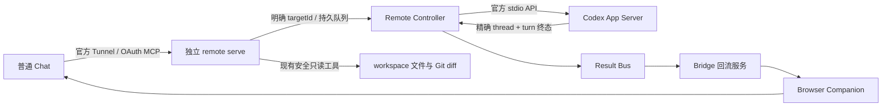

# 官方投递与 Companion 回流

本分支将官方 App Server 作为新任务的执行入口。它复用本机 Codex 登录和配置；MCP 负责有界授权与 workspace 定位，Browser Companion 继续承担普通 Chat 的自动回流。代码能力、隔离回归与真实部署是三个独立验收阶段。

单 workspace 官方路线向单机多 workspace Gateway 的现役后续计划见[统一 Gateway 计划](unified-gateway-plan.md)。本页的现有工具合同和现场成功记录不表示多项目聚合已实现。

## 职责

- `src/remote/store.ts` 是任务、目标和幂等记录的唯一写入口。一个 endpoint 只服务一个固定 workspace；`hostId=local` 表示这个 endpoint 所在机器，不是跨机器可携带的全局身份。
- `targetId` 对应精确 workspace/root/thread。创建线程得到新 target；选择已有线程必须显式提供 thread ID，并由官方 API 核对。提交任务冻结其目标，切换网页或选择其他目标不会改写旧任务。
- `src/remote/controller.ts` 是官方进程和 turn 生命周期的所有者。它不覆盖模型、provider、sandbox 或审批设置，不自动回答服务端审批请求。
- `remote serve` 复用 OAuth、MCP HTTP、路径与敏感文件保护。它不启动 Bridge、Desktop helper、Companion 或 Tunnel；官方 Tunnel 由独立客户端转发到这个入口。
- 独立入口的 OAuth 凭据保存在 `auth/official-mcp/<workspaceId>.json`，Bridge 沿用原凭据文件。两端分别授权，token 不互通、不复制；避免两个进程覆盖同一份内存缓存式 AuthStore。每个 workspace 只运行一个独立官方 MCP 服务。
- `deliveryMode=official` 为本机显式选择。Bridge 在该模式不接受旧 Desktop/Executor 投递，也不消费旧 mailbox，但保留反馈连接、验证与回流。关闭 Remote 授权不会自动退回旧投递。
- 已有部署、旧状态和历史 Desktop receipt 保持兼容；未显式选择官方模式的 workspace 保持旧入口。

## 网页如何选目标

先查独立 endpoint 的 `workspace_info` 和 `codex_list_targets`，核对项目，再创建或选择明确 target。后续 `codex_submit_task` 传 targetId；结果按 taskId 读取。旧 threadId 参数只兼容已经登记、授权的线程，不接受任意路径，不按最近会话或当前目录猜目标。

项目文件由这个 endpoint 的固定 workspace 读取。文件查看不需要猜某个 thread，也不要求 Desktop 空闲。网页回流目标与执行目标独立：结果先排入 Result Bus，预约当前 Active Web Sink，在 begin-send 冻结精确页面；已经开始的发送不会因为切换页面而重发。

这个 workspace 是用户授权共享的项目范围，不是 OAuth 客户端之间的多租户隔离区。官方 MCP 的任务读取与取消核验原 client；另外明确授权并验证的 Feedback/Web Sink 接收整个项目的结果，面板也展示该项目的全部任务，包括其他网页此前派发的任务。这保留“旧网页任务回到新网页”的产品行为；仅有另一客户端的 MCP token 不自动获得 Companion 回流权限，发送开始后也不能把原 attempt 改投新页面。

## 完成、异常与恢复

App Server 的 `completed` 只说明 turn 结束。新的结果来源为 `codex_app_server`，通知使用 `TURN_ENDED`，改动文件标记未采集、测试标记未判定；不产生 `codex_desktop_receipt` 或伪造测试通过。精确 task/thread/turn 身份与脱敏的最终正文持久保存，再幂等投影到同一个 Result Bus。旧 Desktop 的 digest 和消息格式保持不变。

重复 requestId/commandId 返回原记录；参数不同拒绝。启动响应丢失或进程中断保留 `needs_reconciliation`，不会自动重新派发。一个未知 thread 不阻止其他已核验 target；未开始任务可取消，开始后不把“取消排队”冒充停止执行。

接单与派发的短事务先取得该 command 的 lifecycle authority，再更新 Remote 状态；现有历史投递、结果、输出或行政处置占用的 commandId 不能重新执行。终态记录/输出与 Result Bus 投影分段完成，释放各自锁后才标记 Remote 投影完成，不在持有 Remote 写锁时反向申请 command authority。单条锁忙可跳过到其他目标；损坏的权威状态停止相关处理。人工 reconcile 仅结束等待，没有观察到官方终态的记录不会因此生成结果或标记回流成功。

Desktop 接管后可能仍持有 writer，即使 UI 显示空闲。独立 App Server 收到 `already has an active writer` 时明确阻止继续投递，不抢占、不改私有数据库、不换线程。本分支不声称实现了 Desktop 与独立 App Server 对同一个 writer 的无缝控制。

Companion 面板区分官方 turn、旧可信执行记录与网页送达。官方任务的防重放账本不由旧 Desktop 物理清理器删除；面板仍可取消未发送的结果回流、查看结果。结果不明的发送继续保留原 attempt，不能通过换 ID 或清空记录重发。

## 部署与验收边界

经用户单独批准部署后，使用已安装的稳定 launcher：先 `remote enable -w <workspace> --official`，再 `controller start -w <workspace> --codex <已核验的本机Codex>` 与 `remote serve -w <workspace> --port <本地端口> --public-url <明确的HTTPS-origin>`。官方 Tunnel 客户端负责转发 `/mcp`；OAuth 元数据地址必须实际可达，不能从未经核验的请求 Host 推断。首次服务启动会在本机终端显示限时配对码，不把配对码写入文档或聊天。

新建会话使用 `codex_create_thread`，按 requestId 读取成功结果及 targetId。已有会话由本机执行 `remote target select -w <workspace> --thread <threadId> --request <唯一requestId>` 排队核验，`remote target list` 只读查看结果。选择成功不保证另一进程已释放 writer；正式派发仍需官方 API 接受。`codex_cancel_task` 只取消 queued 项，不中断已经开始的 turn。

源码验收截点（2026-10-05 21:10，Asia/Shanghai）仅包含源码、测试和文档；之后才按授权部署，部署状态见下节。在该历史截点，独立 MCP 的官方 Tunnel/OAuth、target 创建/选择、连续任务、结果读取及 Companion 回流尚待真实网页验收；本轮后续完成的范围见当前验收段。target 选择/既有会话与跨进程 writer 移交仍未覆盖。普通 Project Chat 的原生 Events 自动唤醒没有通过，本路线仍依赖 Companion；Work 单次 Events 成功不替代这项验收。

## 源码验收（2026-10-05）

最终冻结版本通过正式串行全量 **164 files /3435 tests**、typecheck 和 canonical build；471 项冻结文件稳定，最终运行新增进程、监听与临时目录均0。构建 stored、重新计算的 artifact ID 与 core-release ID 精确相同：`c4b4c18d050137aaae1130b99257e3e13ded21eefbdf6359db2ee22798e28d97`。门禁失败修订、中止轮留存证据和源码验收截点见[开发计划](development-plan.md)。这些隔离测试不替代真实网页经官方 Tunnel/OAuth 下发、Desktop 会话操作及 Companion 回流验收。

## 历史部署快照（2026-10-05 22:27；gateway 与独立隧道于 2026-10-06 00:31 停止）

该快照记录：稳定 launcher 已安装并运行 build `c4b4c18d050137aaae1130b99257e3e13ded21eefbdf6359db2ee22798e28d97`；workspace `2582910bf0d2` 的 Bridge PID `19516` 健康且 scoped rollout 完成。`deliveryMode=official` 已启用，controller PID `24508`、App Server PID `20172` 及 Codex `0.160.0` 运行。详细部署、状态保留与 GC 记录见[开发计划](development-plan.md)。

该快照记录：新 OAuth origin `https://c2c-official-2582910bf0d2.devworklink.com` 与 Cloudflare tunnel `2186ac70-4742-42a4-90d0-745cc7568402` 已创建；gateway 已监听 `127.0.0.1:48766`（PID `19912`），独立 Cloudflare 与官方 Tunnel 客户端均已启动。22:27 核验本机/公网 OAuth metadata 为 200 且 issuer 精确，匿名 MCP 为 401；官方 Tunnel `/readyz` 为 200，并明确 initialize 仍需授权。网页 OAuth 与真实任务尚未验证，不能把 Tunnel ready 当作用户授权完成。Secure MCP Tunnel 可转发 OAuth discovery，但不会自动转发 authorization server，因此该 origin 使用独立 OAuth store，不复用 Bridge origin/store；见[OpenAI Secure MCP Tunnel 文档](https://developers.openai.com/api/docs/guides/secure-mcp-tunnels)。

截至该历史快照，真实网页工具刷新/OAuth、target 创建/选择、连续投递、结果读取及 Companion 回流仍待验收；旧正式全量结果沿用，本次未重跑。没有 commit/push、supervisor 注册或浏览器扩展 reload。

## 2026-10-06 00:58 部署与 OAuth 历史快照

最新实际 run 的 `.tooling/official-route-deploy-20261005/run-20261005T162626765Z-d6f6ba64590d4a3d85a02743e81c693e/gateway-live.json` 记录独立 gateway 于 2026-10-06 00:31:49 因用户 Ctrl+C 停止；gateway PID `12196`、Cloudflare PID `15448`、官方 Tunnel PID `9368` 均已 missing，本地端口 `48766` 已关闭。这只表示测试入口结束。00:58:32 只读复核确认生产 Bridge PID `19516` 仍 healthy，运行 build 为 `c4b4c18d050137aaae1130b99257e3e13ded21eefbdf6359db2ee22798e28d97`，`runtimeUpgrade.state=current` 且 `upgradePending=false`；Controller PID `24508` 与 App Server PID `20172` 保持原 identity，`deliveryMode=official`，feedback/result-bus inflight 均为 0。bindings、历史记录和其他 workspace runtimes 未变，471 项冻结哈希全部匹配。

00:58 历史阻断状态：最初 trusted-origin 不足导致 Harpoon target=0 并返回 unsupported channel；regex 修正受 `private-host-registration-disabled` 阻止。随后显式登记的 5 个精确 HTTPS 授权地址已加载（target 登记成功，另有两个 OAuth metadata endpoint 返回 200；未执行 register/token/revoke POST 验证；`enabled=true`、`count=5`、`discovery_complete=true`），但网页仍显示“无法发现 OAuth 设置”；8 次 Harpoon 调用的 transport 200 不证明 RPC 成功或授权成功，AuthStore 未创建。不得据此宣称真实网页 OAuth 或任务投递通过。普通 Project Chat 原生 Events 与 Companion 真实回流也尚未验收；当前阻断和下一步见[开发计划](development-plan.md)。本轮仅涉及 ignored 部署脚本与验证，没有业务源码改动，也未重跑正式 full/build；未 install、restart、注册 supervisor，Bridge 原反馈绑定保持不变。

01:45 历史复核（Asia/Shanghai）只读复核确认生产进程 identity、build、bindings/history/其他 workspace 状态仍保持，inflight 为 0；same-origin-auto 候选 runner 已通过离线配置与入口自检但尚未启动。fake control plane A/B 与候选限制、明日验收顺序见[开发计划](development-plan.md)；网页 OAuth、真实投递和 hosted 根因修复仍未验收。

## 首轮网页 OAuth、投递与只读验收（2026-10-06 08:15–08:31，Asia/Shanghai）

用户确认 OAuth 页面显示“已连接并显示工具”，8 个 native OAuth 角色检查通过；readyz HTTP 200 正文含 2s startup probe timeout，fresh 未授权 initialize 本机/公网均返回 401。普通 Chat workspace_info/list_targets 只读检查、唯一 target 创建、task01/task02 按需结果读取及同 thread 连续性均通过。08:25 两条 Result Bus queued 是历史快照；08:31 用户 Connect 后，两条真实 Browser Send+ACK 均已 observed，Companion 回流通过。普通 Chat 原生 Events 仍未通过。本轮输入 Key 启动独立 Gateway/隧道，未重启 Bridge/Controller/App Server；细节与证据见[开发计划](development-plan.md)。

## 最新运行状态（2026-10-06 09:01–09:02，Asia/Shanghai）

08:31–08:34 单 workspace OAuth、两轮官方投递/结果读取及两条 Companion observed 的成功证据见本页上一节和 .tooling/official-route-deploy-20261005/gateway-companion-feedback-acceptance-20261006-verified.json。09:01:03 新鲜只读快照记录 Bridge 为 stopped；旧 durable runtime 记录中的 PID/build 不是存活证明。09:02 早间记录的 Bridge、Controller、App Server、Gateway、PowerShell、Cloudflare 与官方 Tunnel PID 均不在当前进程列表，端口 48766 无监听。恢复未执行，原因未判定；installed build 仍为 c4b4c18d050137aaae1130b99257e3e13ded21eefbdf6359db2ee22798e28d97，但不据此推断 running build。

快照仍记录两条 Result Bus 为 observed、Remote queued/inflight/reconciliation 为 0、maintenance/rollout/start locks 为 0、471 frozen files drift 为 0。下一会话须先重新只读核验 Bridge/Gateway/Controller/App Server/Tunnel 的身份及状态，不自动恢复。多 workspace 目标和 M0–M5 退出条件见[统一 Gateway 计划](unified-gateway-plan.md)。

相关历史实测见[官方投递实验](../experiments/official-dispatch/README.md)和[Events 实验](../experiments/official-events/README.md)。回归仍采用[项目规则](../AGENTS.md)中的定向测试、typecheck、正式串行全量与 canonical build；不使用实验 parallel 代替门禁。
